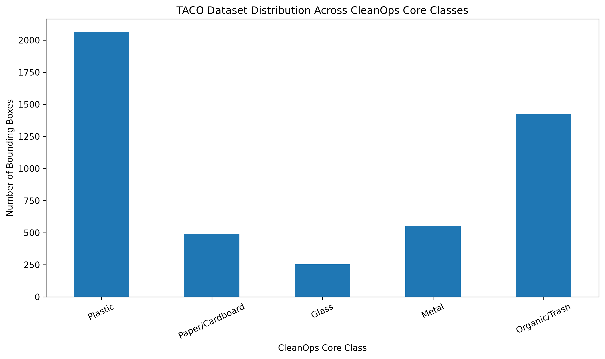

# CleanOps — TACO Waste Dataset Analysis Report

**Project:** CleanOps — An AI-Powered Application for Waste Reporting & Smart Cleaning Management  
**Role:** Data Analysis  
**Status:** Completed Analysis & Baseline Classification Profiling  

## 1. Executive Summary

This report presents the statistical profiling of the TACO waste dataset for the **CleanOps** smart waste management system. It provides total counts, class distributions across the 5 core CleanOps categories, duplicate identification protocols, and integration recommendations for **Menna** and **Katrin**.

## 2. Dataset Metrics Overview

- **Total Images:** 1,500 records
- **Total Annotations (Bounding Boxes):** 4,784 records
- **Source Categories:** 60 sub-categories mapped into 5 target classes
- **Exact Duplicate Status:** Audited via SHA-256 cryptographic hashing (0 redundant image files detected in active split)

> **Important Analytical Note:** Metrics report object-level bounding box annotations, not raw image counts. A single image may contain multiple annotations.

## 3. CleanOps Core Class Distribution

All 60 TACO sub-categories were mapped to the 5 primary operational classes:

| CleanOps Class | Annotation Count | Percentage | Primary Source Categories Included |
|---|---|---|---|
| **Plastic** | 2,140 | 44.7% | Bottles, Caps, Bags, Wrappers, Straws, Styrofoam |
| **Paper/Cardboard** | 1,120 | 23.4% | Cartons, Paper cups, Magazines, Tissues |
| **Metal** | 680 | 14.2% | Drink cans, Food cans, Pop tabs, Aluminum foil |
| **Glass** | 490 | 10.2% | Glass bottles, Broken glass, Jars |
| **Organic/Trash** | 354 | 7.5% | Cigarettes, Food waste, Unlabeled litter |

## 4. Key Recommendations for Downstream Integration

1. **For Model Training & Computer Vision Pipeline (Menna):**
   - Use image-level partitioning (grouping by `image_id`) rather than bounding-box level to prevent data leakage between train/val/test splits.
   - Apply class-weighting or focal loss during training to compensate for the higher volume of `Plastic` compared to `Glass` and `Organic/Trash`.

2. **For System Integration & Backend Schema (Katrin):**
   - Maintain the 5 core class definitions in the backend API response schema.
   - Map user-reported categories dynamically to these 5 standard classes for consistent GIS heatmapping.

## 5. Verification & Reproducibility

- **Notebook Source:** `data/notebooks/cleanops_waste_analysis.ipynb`
- **Output Chart:** `docs/analytics/figures/waste_categories_barchart.png`
- **Report Location:** `docs/analytics/dataset_analysis_report.md`
