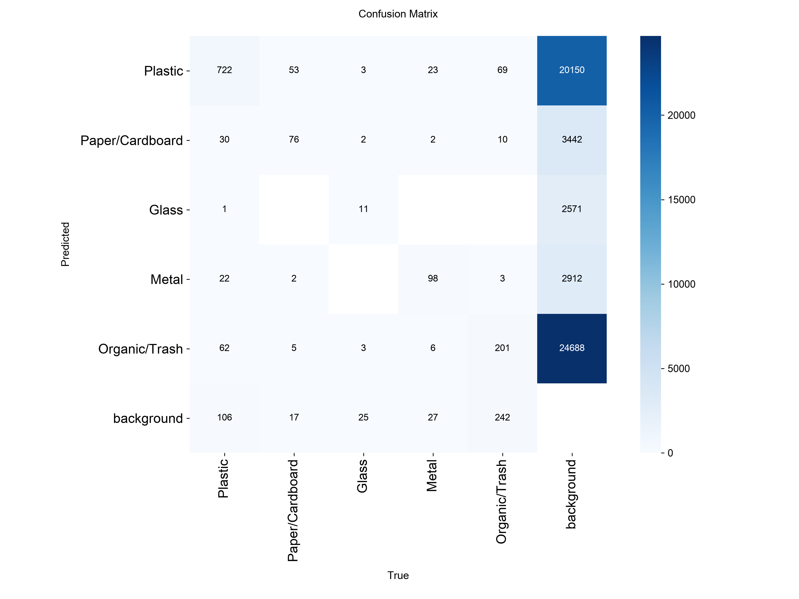

# YOLOv8 Model Evaluation, Confusion Matrix & Error Analysis Report

**Project:** CleanOps — An AI-Powered Application for Waste Reporting & Smart Cleaning Management (Graduation Project)
**Package:** 02 — Core AI Pipeline, Evaluation & Resident UI
**Author / role:** Meray — Data Analysis
**Model under test:** `yolov8n_cleanops_best.pt` (trained by Menna) · **Dataset:** cleaned TACO, test split · **Classes:** Plastic · Paper/Cardboard · Glass · Metal · Organic/Trash

| Deliverable | Path |
|---|---|
| Evaluation notebook | `data/notebooks/yolov8_model_evaluation.ipynb` |
| Confusion matrix (high-res) | `docs/analytics/figures/yolo_confusion_matrix.png` |
| This report | `docs/analytics/model_evaluation_report.md` |
| Supporting files | `docs/analytics/metrics_summary.json`, `docs/analytics/figures/*.png`, `docs/analytics/yolov8n_training_validation_log.csv` |

<!-- BEGIN:status -->
> ⏳ **Evidence status — pending.** The result tables, figures and findings in Sections 1 and 3–9 are filled automatically by running `data/notebooks/yolov8_model_evaluation.ipynb` on the TACO test split (*Run all*). Everything else (setup, definitions, recommendations, defense preparation) is already final and comes from the metadata stored in the weights file and from the project specification.
<!-- END:status -->

**Contents:** 1 Introduction · 2 Dataset & Evaluation Setup · 3 Evaluation Metrics · 4 Confusion Matrix Analysis · 5 Precision–Recall Analysis · 6 Per-Class Performance · 7 Error Analysis · 8 Background Noise Analysis · 9 Model Strengths & Weaknesses · 10 Recommendations · 11 Defense Preparation · Appendices

---

## 1. Introduction

### 1.1 Purpose of the evaluation

CleanOps analyses a citizen-submitted street photo in two stages: a YOLOv8 detector finds *where* litter is, and the result feeds material classification and the priority-scoring formula (proposal §11.1–11.3). Because the detector decides what the operator sees and how many items the priority score counts, its quality must be measured honestly before it is presented in the graduation defense. This report evaluates the trained detector statistically and analytically on data it has never seen, and answers four questions:

1. **How good is it?** — overall and per-class precision, recall and mAP, compared with the working target of mAP@0.5 ≥ 0.50 (spec §9.2).
2. **What does it confuse?** — the official confusion matrix over the five material classes.
3. **Why does it fail?** — a typed error analysis (wrong class, misplaced box, duplicate, background false alarm, missed object), including the effect of object size and background clutter.
4. **What should be done next?** — concrete, evidence-ranked recommendations and defense preparation.

### 1.2 Model under test

All values are read from the metadata embedded in `yolov8n_cleanops_best.pt` (not from memory or from the spec).

| Item | Value |
|---|---|
| Architecture | YOLOv8n — anchor-free, C2f backbone, PAN neck, decoupled head, strides 8/16/32, ≈ 3 M parameters |
| Initial weights | COCO-pretrained `yolov8n.pt` (transfer learning) |
| Classes (`nc = 5`) | 0 Plastic · 1 Paper/Cardboard · 2 Glass · 3 Metal · 4 Organic/Trash (identical to the canonical mapping of the training notebook, Cell 6) |
| Training data config | `cleanops_data.yaml` (cleaned TACO: `train/images`, `valid/images`, `test/images`) |
| Epochs / batch / image size | 50 / 16 / 640 |
| Optimizer | AdamW, lr0 = 0.001111, lrf = 0.01, momentum 0.937, weight decay 5·10⁻⁴, 3 warm-up epochs, seed 0 (deterministic), AMP |
| Augmentation | mosaic 1.0 (off for the last 10 epochs), HSV, translate 0.1, scale 0.5, horizontal flip 0.5, RandAugment, random erasing 0.4 |
| Library / date | Ultralytics 8.4.194 · weights saved 2026-10-31 · training time ≈ 51 min |
| Saved checkpoint | **epoch 46** of 50 (highest validation mAP@0.5:0.95) |

**Deviations from the detection specification** (`yolov8-detection-spec.md`, written before training):

| Topic | Specification | What was actually trained |
|---|---|---|
| Model size | YOLOv8s baseline (n = fallback) | **YOLOv8n** |
| Label space | single-class `litter` detector; material assigned by Stage 2 | **5-class material detector** |
| Epochs | 100 with early stopping | 50 (`patience = 100`, so early stopping never triggered) |
| NMS / `max_det` | 0.70 / 100 (deployment) | 0.70 / 300 (framework validation default, also used here; the deployment cap of 100 only triggers the `dense_scene` flag) |

This evaluation measures the model **as delivered**. Because it already predicts the material, the Stage-2 CNN becomes a second opinion rather than the only source of the material label (see §10.2).

### 1.3 Summary of findings

<!-- BEGIN:exec_summary -->
_Populated by the notebook._
<!-- END:exec_summary -->

---

## 2. Dataset & Evaluation Setup

### 2.1 Test data

The evaluation uses the **cleaned, leakage-free test split of TACO** (`test/images` + `test/labels`, YOLO format, five classes). The cleaning pipeline (`clean_taco.py`) was introduced because the original TACO `valid`/`test` splits were found to contain copies of training photos (24.7 % and 42 % of images, spec §9.2); metrics on the original splits would be inflated. The notebook additionally reports the instance counts per class and split, the number of images without annotation, and an md5 check for byte-identical images shared between training and the evaluated splits (Appendix A).

### 2.2 Evaluation protocol

| Aspect | Choice | Rationale |
|---|---|---|
| Use of the test split | Evaluated **once**, after the settings below were frozen | Spec §5/§12: never tune on test. |
| Operating confidence cut-off | Best micro-F1 on the **validation** split, then frozen | Avoids optimistic bias from tuning on test. |
| mAP / PR curves | `conf = 0.001`, NMS IoU 0.70, `max_det = 300`, `imgsz = 640` | Gives the full precision–recall curve (framework validation defaults). |
| Official numbers | Ultralytics `model.val(split="test")` | Reference values. |
| Own re-computation | Raw predictions re-evaluated with a transparent numpy implementation (101-point interpolated AP, IoU 0.50:0.05:0.95), **cross-checked against the official numbers** in the notebook (warning if they differ by > 0.02) | Needed for the confusion matrix, error taxonomy and bootstrap intervals, which Ultralytics does not expose. |
| Matching | One-to-one greedy matching by descending confidence, IoU ≥ 0.50. P/R/F1 and the taxonomy are *class-aware*; the confusion matrix uses *class-agnostic* box matching so wrong-class detections appear off the diagonal | Ultralytics confusion-matrix convention. |
| Uncertainty | 95 % percentile bootstrap, 300 resamples of **test images** | A modest test split makes point estimates unreliable. |
| Object size | small < 32², medium 32²–96², large ≥ 96² px² (original image pixels) | Spec §9.1 (≈ 60 % of TACO boxes are small). |

### 2.3 Error taxonomy used throughout §7–§8

Evaluated at the operating cut-off and IoU 0.5 (simplified TIDE-style):

| Type | Definition |
|---|---|
| *False positive* — **Classification** | box overlaps a ground-truth object (IoU ≥ 0.5) but the class is wrong |
| *False positive* — **Localisation** | right class, but 0.1 ≤ IoU < 0.5 with the object (box misplaced) |
| *False positive* — **Duplicate** | right class and IoU ≥ 0.5 with an object already matched by a better detection |
| *False positive* — **Background** | overlaps no object (IoU < 0.1): a false alarm on clutter, ground, shadows, etc. |
| *Missed object* — **Misclassified** | an object covered by a detection of the wrong class |
| *Missed object* — **Below threshold** | found with the right class but with confidence under the operating cut-off |
| *Missed object* — **Never detected** | no detection with IoU ≥ 0.5 even at confidence 0.001 |

### 2.4 Prior evidence: the training log (validation split)

The weights file stores the per-epoch log of training. These are **validation-split** numbers (used to pick the checkpoint), so they are *not* an unbiased estimate; they do however describe how training behaved.

| Epoch | mAP@0.5 | mAP@0.5:0.95 | Precision | Recall |
|---:|---:|---:|---:|---:|
| 1 | 0.098 | 0.060 | 0.353 | 0.153 |
| 10 | 0.169 | 0.106 | 0.399 | 0.246 |
| 20 | 0.237 | 0.155 | 0.453 | 0.289 |
| 30 | 0.305 | 0.200 | 0.389 | 0.344 |
| 40 | 0.361 | 0.244 | 0.435 | 0.380 |
| **46 (saved weights)** | **0.391** | **0.275** | **0.507** | **0.392** |
| 50 (last) | 0.401 | 0.272 | 0.510 | 0.419 |

1. **Under-trained, not over-fitted.** Validation mAP@0.5 climbed from 0.361 (epoch 40) to 0.401 (epoch 50) and recall rose almost monotonically from 0.15 to 0.42; the validation class loss reached its minimum at the *last* epoch (1.350).
2. **Train/validation gap.** At epoch 50 the class loss is 0.78 (train) vs 1.35 (validation) and the box loss 0.96 vs 1.20. Part of the widening in the last ten epochs is expected: training losses drop sharply at epoch 41 (class loss 1.06 → 0.99 → 0.93) exactly when mosaic augmentation is switched off.
3. **Noisy validation precision.** Precision swings between 0.27 and 0.62 over epochs 26–50 while recall changes smoothly; the mean mAP@0.5 of the last ten epochs is 0.384 ± 0.013 (s.d.). Single-epoch precision is a weak basis for conclusions — one reason this report uses a confidence sweep and bootstrap intervals.
4. **Checkpoint choice.** The saved weights (epoch 46) maximise mAP@0.5:0.95, while epoch 50 has a slightly higher mAP@0.5 (0.401 vs 0.391); the difference is within epoch-to-epoch noise.

---

## 3. Evaluation Metrics

### 3.1 Definitions

A detection is a **true positive (TP)** if its class is correct and its box overlaps a not-yet-matched ground-truth box with **IoU ≥ threshold** (Intersection over Union = overlap area ÷ union area). A detection that matches nothing is a **false positive (FP)**; a ground-truth object that no detection matches is a **false negative (FN)**.

| Metric | Formula | What it answers for CleanOps |
|---|---|---|
| **Precision** | TP / (TP + FP) | Of the items the AI reports, how many are real and correctly labelled? Low precision → operators waste time on false alarms and the *quantity* factor is inflated. |
| **Recall** | TP / (TP + FN) | Of the real items in the photo, how many does the AI find? Low recall → litter is missed and a report may look cleaner than it is. |
| **F1** | 2·P·R / (P + R) | Single balance of the two; used to choose the operating confidence cut-off. |
| **AP@0.5** (per class) | Area under that class's precision–recall curve at IoU 0.5 (101-point interpolation) | Quality of the class across *all* confidence thresholds, independent of any chosen cut-off. |
| **mAP@0.5** | Mean of AP@0.5 over the five classes | **Primary metric** (proposal §22); target ≥ 0.50. |
| **mAP@0.5:0.95** | Mean AP over IoU 0.50, 0.55, …, 0.95 | Rewards tight boxes; always lower than mAP@0.5. The ratio of the two measures localisation quality. |
| **Confusion matrix** | counts of (true class, predicted class), plus a Background row/column | Shows *which* classes are mixed up and where objects are missed or invented. |
| **Bootstrap 95 % CI** | percentile interval over 300 resamples of test images | How much the number could change with a different sample of images. |

Two aggregation rules: **mAP and macro-F1** average over classes (every class counts equally); **"ALL" precision/recall/F1** are micro-averaged over all objects (reflecting the real mix of litter).

### 3.2 Headline results

<!-- BEGIN:results_overall -->
_Populated by the notebook._
<!-- END:results_overall -->

---

## 4. Confusion Matrix Analysis

**How to read it.** Rows are the *true* class, columns the *predicted* class. The diagonal is a correct detection. Off-diagonal cells inside the 5×5 block are **class confusions** (the model found the object but named the wrong material). The **Background column** counts objects the model missed (false negatives); the **Background row** counts detections on empty regions (false positives). The right panel is row-normalised, so its diagonal equals the per-class recall at the operating point.

**What to look for (and how it is analysed below):** (a) classes with a low diagonal share — the model fails to find them; (b) a large off-diagonal cell — two materials are visually or semantically confusable; (c) a heavy Background column vs a heavy Background row — a recall problem vs a false-alarm problem.

<!-- BEGIN:confusion_notes -->
_Populated by the notebook._
<!-- END:confusion_notes -->

---

## 5. Precision–Recall Analysis

**How to read the curves.** *Left:* precision (y) against recall (x) as the confidence cut-off sweeps from high to low; a curve that stays high and far to the right is better, and the area under it is the AP. A curve that drops quickly means the model's confident detections are accurate but only a few; a flat curve that ends early means many objects never receive any detection. *Middle:* the F1–confidence curve shows the cut-off that balances precision and recall; the dotted line marks the cut-off frozen on the validation split — a test peak close to it confirms the cut-off transfers. A broad flat peak means the threshold is not sensitive; per-class curves that peak at different values would justify per-class thresholds.

### 5.1 Confidence-threshold trade-off (test split)

<!-- BEGIN:threshold_sweep -->
_Populated by the notebook._
<!-- END:threshold_sweep -->

Raising the cut-off trades recall for precision. The specification keeps detections between 0.25 and 0.50 with a `low_det_conf` flag so the operator can judge them; the table shows what that policy costs and buys.

---

## 6. Per-Class Performance

Comparison of the five material classes (Plastic, Paper/Cardboard, Glass, Metal, Organic/Trash):

<!-- BEGIN:results_per_class -->
_Populated by the notebook._
<!-- END:results_per_class -->

*Instances* = annotated test objects. P / R / F1 are at the frozen operating cut-off; the AP columns use all detections down to conf = 0.001 (see the right panel of the figure in §5 for the bar chart). **Wide confidence intervals mark classes with few test objects — compare such classes cautiously.** Class-level differences should be read together with the confusion matrix (§4) and the class-by-size recall table (§7.3): a class can score low because it is *confused with another class*, because it is *small*, or because it is *heterogeneous* (a catch-all such as Organic/Trash).

---

## 7. Error Analysis

### 7.1 Error taxonomy per class

Definitions are in §2.3.

<!-- BEGIN:error_taxonomy -->
_Populated by the notebook._
<!-- END:error_taxonomy -->

### 7.2 Pre-stated hypotheses and their outcome

These hypotheses were written from the dataset audit in the detection specification (59.9 % small boxes, catch-all labels) **before** the test run; the notebook evaluates each one numerically and reports *Supported / Not supported / Inconclusive*, so no conclusion rests on impression.

<!-- BEGIN:hypotheses -->
_Populated by the notebook._
<!-- END:hypotheses -->

### 7.3 Effect of object size

<!-- BEGIN:size_analysis -->
_Populated by the notebook._
<!-- END:size_analysis -->

### 7.4 Visual examples

*Green dashed = ground truth; red = prediction at or above the operating cut-off. Top row: the highest-confidence false positives; bottom row: the largest objects that were never detected.*

---

## 8. Background Noise Analysis

Street photos contain pavement, vegetation, shadows, shop fronts and other clutter that resembles litter. "Background noise" here means **detections that fire where no annotated object exists** (the *Background* false-positive type) and images that contain no annotated litter at all but still trigger the detector.

<!-- BEGIN:background_analysis -->
_Populated by the notebook._
<!-- END:background_analysis -->

**Why this matters operationally.** (1) Every background false alarm that survives the cut-off inflates the number of boxes and therefore the *quantity* factor of the priority-scoring formula (proposal §11.3); (2) it sends the operator to inspect a non-existent item; (3) a high confidence on a background box shows the cut-off alone cannot remove it — hence the recommendation of hard-negative training images (§10). The right-hand panel shows whether confidence separates true detections from false ones, which decides how much a higher cut-off can help.

---

## 9. Model Strengths & Weaknesses

### 9.1 Strengths

<!-- BEGIN:strengths -->
_Populated by the notebook._
<!-- END:strengths -->

### 9.2 Weaknesses / failure modes

<!-- BEGIN:failure_modes -->
_Populated by the notebook._
<!-- END:failure_modes -->

---

## 10. Recommendations

### 10.1 Improvement roadmap (ordered by evidence)

1. **Train longer.** The validation curves had not plateaued at epoch 50 (§2.4): 100–150 epochs with early stopping is the cheapest expected gain.
2. **Move to YOLOv8s** (the specification's baseline) if the latency budget allows; benchmark both with the 100-image latency protocol of the specification (§9.3 there) on the *target server* — the speed in §3.2 is measured on the evaluation machine only.
3. **Run the `imgsz` 416 vs 640 ablation** from the specification, judged on small-object recall (§7.3).
4. **Act on the dominant error type found in §7.1:** background false alarms → add hard-negative (empty-scene) images and raise the cut-off for the affected classes; classification errors → revisit the class definitions or merge visually ambiguous materials; missed small objects → higher resolution or tiling; localisation errors → more epochs or a higher box-loss weight.
5. **Per-class confidence thresholds** if the per-class F1–confidence curves (§5) peak at clearly different cut-offs.
6. **Repeat training with 3 seeds** to separate real differences from run-to-run noise (the log shows ±0.013 mAP@0.5 between neighbouring epochs).
7. **Collect a small pilot set of real citizen photos** (even ~100) to measure the gap between TACO photos and the photos CleanOps will actually receive.

### 10.2 Implications for the CleanOps pipeline

| Pipeline element | Implication of this evaluation |
|---|---|
| **Stage 1 deployment cut-off** | Use the validation-tuned operating point (§5.1) as the *keep* threshold and retain the two tiers of the spec: ≥ 0.50 *confident*, below that flagged `low_det_conf`. |
| **Stage 2 classifier** | The delivered detector already outputs a material class. Treat the Stage-2 CNN as a second opinion: where both agree confidence is high; where they disagree, raise the existing `low_cls_conf` flag. The confusions in §4 show which material pairs most need it. |
| **Priority scoring (quantity factor)** | Use the counting statistics of §8 to decide whether the number of boxes needs a correction factor or should be combined with box area. |
| **Operator workflow** | Background false alarms and misses (§7–§8) are why the system keeps *"AI assists, the operator decides"* and routes `no_waste_detected` reports to manual review. |
| **Documentation alignment** | The spec (§2–§7) describes a YOLOv8s single-class detector; the delivered model is YOLOv8n with five classes (§1.2). One of the two should be updated so the defense dossier is internally consistent. |

---

## 11. Defense Preparation

### 11.1 Key talking points

- The test split was used **once**; the operating threshold was frozen on validation first; the notebook cross-checks its own metrics against Ultralytics' official ones and checks for duplicate images between train and test.
- Results are given with **95 % confidence intervals**, not just point values.
- Errors are **typed** (wrong class, misplaced box, duplicate, background, miss), so every weakness points to a specific fix.
- The model is deliberately small (YOLOv8n) for fast citizen feedback; the accuracy–latency trade-off and the upgrade path are documented.
- Training had not converged (§2.4), so the current numbers are a **lower bound**, not a ceiling.

### 11.2 Questions the committee is likely to ask

| Question | Evidence-based answer |
|---|---|
| *Why YOLOv8n and not a larger model?* | It is the lightest variant (≈ 3 M parameters), chosen for fast feedback to citizens; the spec names YOLOv8s as the accuracy/speed baseline and §10.1 includes it. The trade-off is a deliberate design choice. |
| *Is the model over-fitted?* | No evidence in the logs: validation loss was still decreasing at the end of training (§2.4). Hypothesis H6 (§7.2) compares test and validation mAP directly. |
| *How do you know the test numbers are honest?* | One-time test use, threshold fixed on validation, duplicate-image check, and official-vs-own metric cross-check (§2.2). |
| *Why is mAP@0.5:0.95 so much lower than mAP@0.5?* | It averages over IoU thresholds up to 0.95, which is demanding for small, irregular litter; the ratio of the two (§9) quantifies localisation quality. |
| *Which classes can we trust?* | See §6: trust is limited for classes with few test instances (wide interval) and for the classes with the lowest AP. |
| *What happens when the model is wrong?* | Errors are typed (§7); operators review flagged and empty-result reports and can override every AI result. |
| *What is the biggest deployment risk?* | Domain shift from TACO photos to citizen photos (§11.3) — hence the pilot-set recommendation. |
| *Does the model meet the target?* | Compare the test mAP@0.5 and its interval with 0.50 in §3.2; the target was written for another dataset and is "to be confirmed after the first baseline" (spec §9.2). |

### 11.3 Limitations and threats to validity

- **Single training run** (seed 0): run-to-run variance is not measured.
- **Test-set size:** bootstrap intervals (§3.2, §6) express this uncertainty.
- **Image independence:** the bootstrap treats images as independent; photos of the same scene (e.g. flipped/rotated copies that survived cleaning) make the intervals slightly too narrow.
- **Annotation noise:** TACO labels are crowd-sourced; some "false positives" may be unlabelled real litter, which makes precision conservative.
- **Label simplification:** TACO's 18 categories were mapped to five classes; "Organic/Trash" contains catch-all items and is inherently heterogeneous.
- **Domain shift:** results describe TACO-style photos, not yet CleanOps citizen uploads.
- **Fixed matching IoU of 0.5** for the confusion matrix and taxonomy (mAP@0.5:0.95 covers stricter thresholds).
- **Latency** in §3.2 is the evaluation machine's, not the production server's.

---

## Appendix A — Reproducibility

<!-- BEGIN:repro -->
_Populated by the notebook._
<!-- END:repro -->

**How to reproduce**

1. Place `yolov8n_cleanops_best.pt` in `models/` and the cleaned TACO dataset in `data/TACO_clean/` (folders `train/`, `valid/`, `test/`, each with `images/` and `labels/`), or edit the two path variables in cell 1 of the notebook.
2. Open `data/notebooks/yolov8_model_evaluation.ipynb` (Colab or local, `pip install ultralytics`) and choose *Run all*.
3. The notebook writes all figures to `docs/analytics/figures/`, the metrics to `docs/analytics/metrics_summary.json`, and fills the marked sections of this report.

## Appendix B — Checkpoint metadata

| Field | Value |
|---|---|
| Logged validation metrics (saved epoch 46) | precision 0.507 · recall 0.392 · mAP@0.5 0.391 · mAP@0.5:0.95 0.275 |
| Last-epoch (50) validation metrics | precision 0.510 · recall 0.419 · mAP@0.5 0.401 · mAP@0.5:0.95 0.272 |
| Mean mAP@0.5, epochs 41–50 | 0.384 (s.d. 0.013) |
| Per-epoch log | `docs/analytics/yolov8n_training_validation_log.csv` |
| Checkpoint state | stripped for deployment (`epoch = −1`); weights stored in half precision (6.2 MB) |

*Per-class results are not stored in the checkpoint; every per-class figure in this report comes exclusively from the test-split run in the notebook.*
