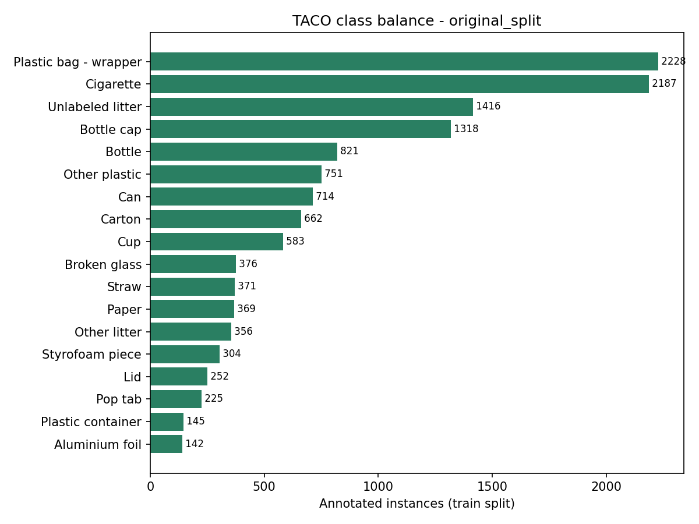
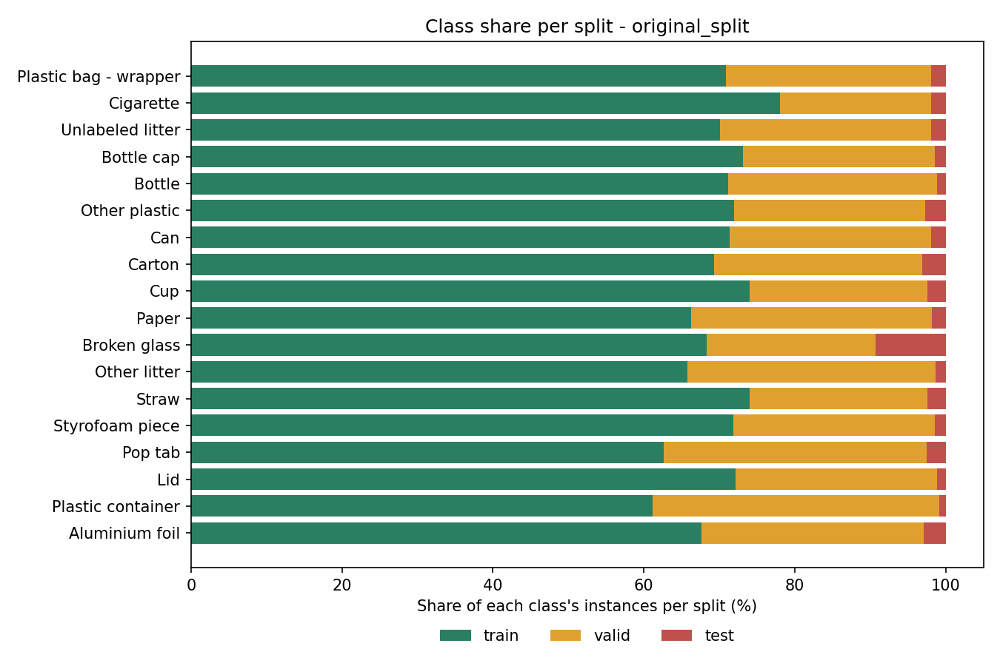
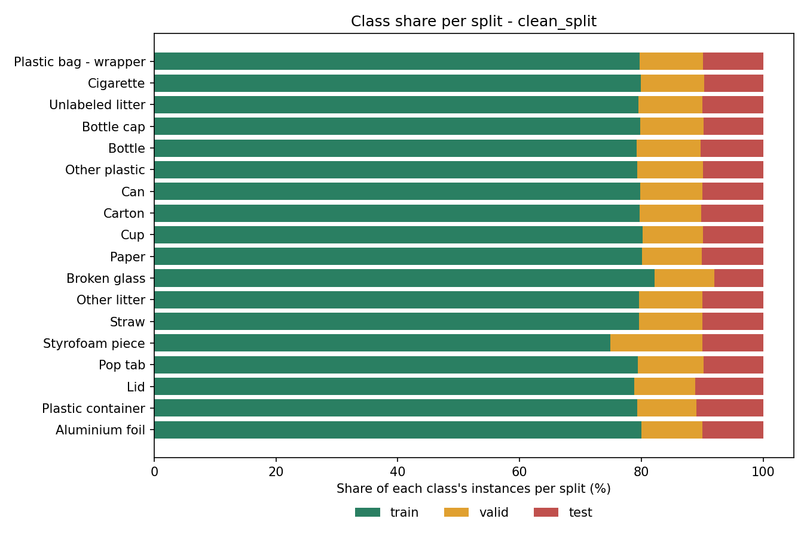

# TACO Waste Detection Dataset — Analysis & Cleaning Report

**Task:** TACO Waste Detection Dataset Analysis & Cleaning Pipeline
**Package:** Computer Vision Pipeline & Dataset Preparation
**Deliverables:** this report (`docs/design/ai/taco-dataset-analysis.md`) + cleaning script (`scripts/ai/clean_taco.py`)
**Machine-readable results:** [`taco_audit_report.json`](taco_audit_report.json) (produced by the script)

All numbers below were measured by running `scripts/ai/clean_taco.py` on the dataset file `TACO.zip` (Kaggle: *TACO Dataset YOLO Format*, 242 MB). Nothing here is estimated from the dataset description.

---

## 1. Executive Summary

| # | Finding | Impact |
|---|---|---|
| 1 | The export contains **6,004 images but only 3,665 distinct photographs**. The rest (~39%) are flipped/rotated copies created by Roboflow augmentation. | Class counts and "dataset size" are inflated by ~1.6×. |
| 2 | **Data leakage between splits:** 24.7% of `valid` images (421/1,704) and 42% of `test` images (42/100) are copies of photos that are also in `train`. | mAP measured on the original `valid`/`test` is optimistic and must not be reported as a result. |
| 3 | The original `test` split is only **100 images / 394 boxes**; several classes have 2–9 test instances. | Per-class test metrics are statistically meaningless. |
| 4 | **Strong class imbalance:** 15:1 between the largest (*Plastic bag – wrapper*, 3,141) and smallest (*Aluminium foil*, 210) class. | Rare classes will under-perform without class weighting/oversampling. |
| 5 | **Objects are small:** 59.9% of training boxes are smaller than 32×32 px (median box ≈ 23×23 px) at the 416×416 export resolution. | Hard for the detector; the proposal's mAP target needs re-baselining (see §8). |
| 6 | **Glass is thin:** there is no `Glass` class. `Broken glass` has 550 boxes but comes from only **39 distinct photos**. | Low diversity; local collection recommended. |
| 7 | **Label quality is otherwise clean:** 0 malformed lines, 0 invalid class IDs, 0 out-of-bounds boxes, 0 corrupt images, 0 orphans, 0 empty label files. 40 boxes (0.2%) were thinner than 1 px and removed. | Format conversion is not needed — the data is already valid YOLO. |

---

## 2. Dataset Description

| Property | Value |
|---|---|
| Source | TACO (*Trash Annotations in Context*), Roboflow project `divya-lzcld/taco-mqclx`, **v3**, republished on Kaggle (*TACO Dataset YOLO Format*) |
| License | CC BY 4.0 (cite original creators) |
| Annotation format | YOLO `.txt`: `class_id x_center y_center width height` (normalized 0–1) |
| Files | 12,011 = 6,004 images + 6,004 label files + `data.yaml` + 2 README files |
| Splits | train **4,200**, valid **1,704**, test **100** images |
| Image size | **All 6,004 images are 416×416** (Roboflow *stretch* resize, auto-orientation applied) |
| Roboflow augmentation | 2 versions per source image: 50% horizontal flip, 50% vertical flip, random 90° rotation (none / clockwise / upside-down) |
| Classes (`nc`) | **18** |

**Classes (index order):** Aluminium foil, Bottle cap, Bottle, Broken glass, Can, Carton, Cigarette, Cup, Lid, Other litter, Other plastic, Paper, Plastic bag – wrapper, Plastic container, Pop tab, Straw, Styrofoam piece, Unlabeled litter.

> Note: this Roboflow export has **18 classes**, not the 60 categories of the original TACO release.

---

## 3. Annotation & Image Audit

### 3.1 Integrity checks

| Check | Result |
|---|---|
| Image files readable (not corrupt) | 6,004 / 6,004 ✅ |
| Every image has a label file / every label has an image | ✅ no orphans |
| Empty label files (background images) | 0 |
| Malformed lines (≠ 5 fields) / non-numeric values | 0 |
| Class IDs outside `0..17` | 0 |
| Boxes outside image bounds (tolerance 1%) | 0 |
| Exactly duplicated boxes within one image | 0 |
| **Degenerate boxes (width or height < 1 px)** | **40 (0.2%) — removed** |

Annotation counts: train 13,250 → **13,220**, valid 4,830 → **4,820**, test 394 → **394** (total 18,474 → **18,434** after removing the 40 degenerate boxes).

### 3.2 Boxes per image

| Split | Images | Annotations | Mean boxes/img | Median | Max |
|---|---|---|---|---|---|
| train | 4,200 | 13,220 | 3.15 | 2 | 90 |
| valid | 1,704 | 4,820 | 2.83 | 2 | 90 |
| test | 100 | 394 | 3.94 | 2 | 54 |

Most images contain 1–3 objects, but a few scenes are extremely dense (up to 90 boxes), typically cigarette butts / small items.

### 3.3 Image resolution and object size

- **Resolution:** a single size, 416×416, for all images (no mixed resolutions to normalize). The *stretch* resize distorts the aspect ratio of the original photos and the original detail cannot be recovered from this export.
- **Object size** (box area in pixels at 416×416; COCO-style buckets, small < 32², medium 32²–96², large ≥ 96²):

| Split | Median box area | 10th pct | 90th pct | Small | Medium | Large |
|---|---|---|---|---|---|---|
| train | 520 px² (~23×23 px) | 20 | 10,947 | **59.9%** | 28.6% | 11.5% |
| valid | 654 px² | 33 | 14,250 | 56.6% | 30.6% | 12.8% |
| test | 490 px² | 25 | 12,932 | 59.9% | 25.9% | 14.2% |

---

## 4. Class Distribution (class balance)

Counts are for the original splits after removing the 40 degenerate boxes. *Distinct photos* counts each photograph once, ignoring flipped/rotated copies.

| Class | Boxes | % of boxes | Images with class | Distinct photos | train | valid | test |
|---|---|---|---|---|---|---|---|
| Plastic bag – wrapper | 3,141 | 17.0% | 2,007 | 1,217 | 2,228 | 854 | 59 |
| Cigarette | 2,801 | 15.2% | 918 | 592 | 2,187 | 559 | 55 |
| Unlabeled litter | 2,021 | 11.0% | 1,051 | 644 | 1,416 | 567 | 38 |
| Bottle cap | 1,803 | 9.8% | 1,297 | 769 | 1,318 | 459 | 26 |
| Bottle | 1,154 | 6.3% | 936 | 578 | 821 | 320 | 13 |
| Other plastic | 1,044 | 5.7% | 659 | 403 | 751 | 265 | 28 |
| Can | 1,000 | 5.4% | 670 | 384 | 714 | 267 | 19 |
| Carton | 955 | 5.2% | 724 | 454 | 662 | 263 | 30 |
| Cup | 788 | 4.3% | 661 | 393 | 583 | 186 | 19 |
| Paper | 557 | 3.0% | 427 | 270 | 369 | 178 | 10 |
| **Broken glass** | **550** | 3.0% | **55** | **39** | 376 | 123 | 51 |
| Other litter | 541 | 2.9% | 454 | 274 | 356 | 178 | 7 |
| Straw | 501 | 2.7% | 430 | 264 | 371 | 118 | 12 |
| Styrofoam piece | 423 | 2.3% | 295 | 177 | 304 | 113 | 6 |
| Pop tab | 359 | 1.9% | 255 | 153 | 225 | 125 | 9 |
| Lid | 349 | 1.9% | 295 | 155 | 252 | 93 | 4 |
| Plastic container | 237 | 1.3% | 230 | 132 | 145 | 90 | 2 |
| Aluminium foil | 210 | 1.1% | 143 | 92 | 142 | 62 | 6 |





**Observations**

1. **Imbalance ratio ≈ 15:1** (3,141 vs 210). The top 4 classes hold 53% of all boxes.
2. **Catch-all classes:** *Unlabeled litter* + *Other litter* = 2,562 boxes (**13.9%**) with no material meaning — ambiguous labels for any material-level use.
3. **Glass:** there is no generic `Glass` class. Glass appears as `Broken glass` (550 boxes in 55 images, only 39 distinct photos, ≈ 9 boxes per photo — a few scenes with many shards) and glass bottles are merged into `Bottle` (material not distinguished).
4. **Original test split is unrepresentative:** 100 images, with 2–9 boxes for six classes (*Plastic container* 2, *Lid* 4, *Styrofoam* 6, *Aluminium foil* 6, *Other litter* 7, *Pop tab* 9) and 13% of its boxes being *Broken glass* (vs. 3.0% overall).

---

## 5. Data Leakage & Duplicate Analysis

**Method.** Each image gets a 64-bit difference-hash (dHash) computed over all 8 flip/rotation variants and the minimum is kept, so a photo and its flipped/rotated copies share one fingerprint. Images with the same fingerprint form one *photo group*.

| Measure | Result |
|---|---|
| Images | 6,004 |
| **Distinct photographs (groups)** | **3,665** → ~39% of images are redundant augmented copies |
| Groups appearing in more than one split | **420** |
| `valid` images that have a copy in `train` | **421 / 1,704 (24.7%)** |
| `test` images that have a copy in `train` | **42 / 100 (42.0%)** |

**Verification.** Pixel-level comparison (mean squared error at 104×104, best of 8 orientations) confirmed these are true copies: flagged cross-split pairs have a median MSE of 11–14, comparable to known augmented pairs inside `train` (median 31) and **~250× lower** than random unrelated image pairs (median ≈ 3,600).

**Sensitivity.** With a looser match (Hamming distance ≤ 2) the number of photo groups crossing splits rises to **622**, so the figures above are a **lower bound**.

**Consequence.** Any mAP computed on the original `valid`/`test` partly measures memorization of training photos. Results must be reported on the leakage-free split produced by the cleaning script.

---

## 6. Cleaning Pipeline (`scripts/ai/clean_taco.py`)

| Step | What it does |
|---|---|
| 1. Audit | Parses all labels and images; counts every defect type; computes per-split class/box/size statistics. |
| 2. Clean | Clips boxes slightly outside the image; drops malformed lines, invalid class IDs, non-positive/degenerate boxes (< 1 px, configurable), exact duplicate boxes, corrupt images, orphan images/labels. |
| 3. Group | Computes the flip/rotation-invariant dHash and groups images that are the same photograph (`--hamming N` for fuzzier matching). |
| 4. Split | `--split-mode regroup` (default): leakage-free, **class-stratified** re-split by photo group (default 80/10/10, `--ratios`). `--split-mode keep`: keep the original splits and only report leakage. |
| 5. Export | Writes `train/valid/test` images + labels, a valid `data.yaml`, the JSON report and PNG charts. |

**Options:** `--audit-only` (report without writing a dataset) · `--dedupe-groups` (keep one image per photo) · `--classes-mode single` (collapse to one `litter` class for a detection-only stage, matching the two-stage architecture) · `--link` (symlink instead of copy) · `--seed`.

**Run**

```bash
pip install numpy pillow pyyaml matplotlib

# Audit only
python scripts/ai/clean_taco.py --src data/TACO --audit-only \
  --report docs/design/ai/taco_audit_report.json --figures-dir docs/design/ai/figures

# Clean + leakage-free stratified re-split (writes data/TACO_clean)
python scripts/ai/clean_taco.py --src data/TACO --out data/TACO_clean \
  --report data/TACO_clean/taco_report.json --figures-dir data/TACO_clean/figures
```

### 6.1 Result of the cleaning run

| Split | Images | Boxes | Photo groups shared with another split |
|---|---|---|---|
| train | 4,817 | 14,684 | |
| valid | 580 | 1,929 | **0** |
| test | 607 | 1,821 | |
| **Total** | **6,004** | **18,434** | **0** (was 420) |

- No annotation was lost except the 40 degenerate boxes; all 6,004 images are kept.
- Every class is now spread ≈ 80 / 10 / 10 across train / valid / test (e.g. *Plastic container* 188 / 23 / 26 instead of 145 / 90 / 2; *Lid* 275 / 35 / 39 instead of 252 / 93 / 4).
- The re-split output was re-validated: 0 invalid label lines.



### 6.2 Optional de-duplicated variant (`--dedupe-groups`)

Keeps one image per photograph: **3,665 images / 11,310 boxes** → train 2,921 / valid 367 / test 377. Recommended when you want the true dataset size and the training framework (e.g. YOLOv8) applies its own flip/rotation/mosaic augmentation, since the pre-baked copies add little new information.

---

## 7. Limitations (stated explicitly)

1. **Rare-class evaluation remains thin.** `Broken glass` exists in only 39 distinct photos; in the de-duplicated split it appears in 32 / 5 / 2 photos (train / valid / test). Per-class AP for it should be reported with a caution.
2. **Resolution is fixed at 416×416 (stretched).** The original photo resolution and aspect ratio are not available in this export.
3. **Leakage figures are a lower bound** (exact-hash match; looser matching finds more).
4. **Geographic/domain shift** is not measurable from this dataset: it contains no local (Egyptian) street imagery. A small locally collected set is still required for fine-tuning and for an honest real-world evaluation.

---

## 8. Recommendations

1. **Train and evaluate only on the cleaned, group-aware split** (`data/TACO_clean`). Never report metrics from the original `valid`/`test`.
2. **Decide the detector's label space deliberately.** For the two-stage pipeline (detector → per-crop classifier) use `--classes-mode single` (class `litter`) so the detector only localizes; keep the 18-class model as a comparison baseline.
3. **Treat *Unlabeled litter* / *Other litter* (13.9% of boxes) with care** in any classification-oriented use: they carry no material information.
4. **Handle imbalance:** class-weighted loss and/or oversampling for the 5 rarest classes (< 450 boxes each: Aluminium foil, Plastic container, Lid, Pop tab, Styrofoam piece).
5. **Plan for small objects:** 60% of boxes are < 32×32 px. Prefer a higher training image size where the source allows it, and evaluate AP for small/medium/large separately.
6. **Re-baseline the success criterion.** The proposal's target (mAP@0.5 ≥ 0.5) was written against the Domestic Trash / Garbage dataset. With TACO the target should be restated against the cleaned TACO test split once a first baseline is trained, rather than assumed.
7. **Collect a local image set** (already planned) with extra coverage of glass, which is under-represented here.
