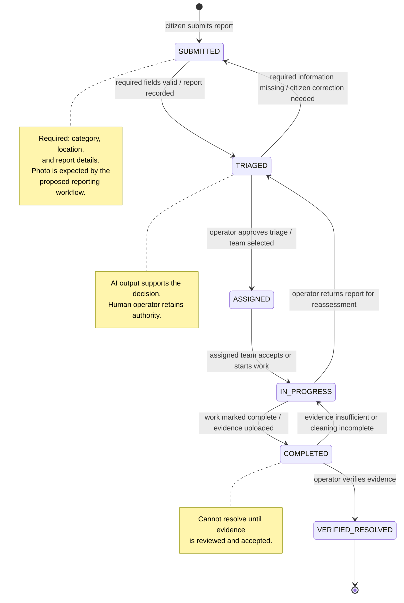

# CleanStreet AI — Report Lifecycle State Machine & Transition Rules

## 1. Purpose

This document defines the report lifecycle for CleanStreet AI. It follows the project proposal's citizen-reporting and operator workflow: a citizen submits a waste report, the system analyses it, an operator reviews and prioritises it, a cleaning team is assigned, work is completed, and completion evidence is checked before the report is resolved.

AI supports image analysis and prioritisation, but the responsible human operator makes the final operational decision.

## 2. Report states

| State | Meaning |
|---|---|
| `SUBMITTED` | A citizen has submitted a report with the required report details. |
| `TRIAGED` | The report has been reviewed, categorised, and assessed for priority. |
| `ASSIGNED` | A responsible cleaning team has been assigned. |
| `IN_PROGRESS` | The assigned team is carrying out the cleaning work. |
| `COMPLETED` | The team has marked the work complete and submitted completion evidence. |
| `VERIFIED_RESOLVED` | An authorised operator has checked the evidence and confirmed resolution. |

`COMPLETED` and `VERIFIED_RESOLVED` are separate states. A team's completion update alone does not close a report; the operator must review the completion evidence.

## 3. UML state machine diagram

## 4. Transition rules and guards

| Current state | Event / requested transition | Guard conditions (must be true) | Next state | If guard fails |
|---|---|---|---|---|
| None | Citizen submits report | Authenticated citizen; required report details and location are present; submitted image is stored when provided by the workflow | `SUBMITTED` | Reject submission and return validation errors |
| `SUBMITTED` | Validate and triage report | Report record exists; required fields are valid; category is available; location data is usable for mapping | `TRIAGED` | Keep as `SUBMITTED`; request correction or flag for operator review |
| `TRIAGED` | Assign report | An authorised operator approves the triage; a valid cleaning team is selected | `ASSIGNED` | Remain `TRIAGED`; do not create an assignment |
| `ASSIGNED` | Start work | An active assignment exists for the report and the assigned team is authorised to update it | `IN_PROGRESS` | Remain `ASSIGNED`; reject the status change |
| `IN_PROGRESS` | Mark work complete | An active assignment exists; the team submits completion details and completion evidence | `COMPLETED` | Remain `IN_PROGRESS`; request missing evidence/details |
| `COMPLETED` | Verify completion | An authorised operator reviews the evidence and confirms the reported issue has been addressed | `VERIFIED_RESOLVED` | If evidence is insufficient, return to `IN_PROGRESS` |
| `COMPLETED` | Reject completion evidence | Operator finds that the cleaning is incomplete or evidence is inadequate | `IN_PROGRESS` | Only an authorised operator can perform this transition |
| `IN_PROGRESS` | Return for reassessment | An authorised operator identifies a priority/category or report-handling issue requiring triage again | `TRIAGED` | Remain `IN_PROGRESS`; reject unauthorised request |
| `TRIAGED` | Request citizen correction | Operator determines required information is missing or incorrect and the citizen must correct it | `SUBMITTED` | Remain `TRIAGED` if no correction request is justified |

## 5. Invalid transitions

The backend must reject the following transitions. It must not update `current_status` when a transition is invalid.

| Invalid transition / request | Reason |
|---|---|
| `SUBMITTED` → `ASSIGNED` | The report must be triaged before assignment. |
| `SUBMITTED` → `IN_PROGRESS` | A team cannot start work before triage and assignment. |
| `TRIAGED` → `IN_PROGRESS` | A cleaning team must be assigned first. |
| `ASSIGNED` → `COMPLETED` | Work must pass through `IN_PROGRESS`; completion evidence is required. |
| `IN_PROGRESS` → `VERIFIED_RESOLVED` | The team must first submit completion evidence, then an operator must verify it. |
| `COMPLETED` → `VERIFIED_RESOLVED` without evidence review | Resolution requires an authorised operator's verification. |
| Any state → any unknown status | The requested status is not part of the defined lifecycle. |
| Any status update by an unauthorised user | Only permitted roles may perform each transition. |
| Any update using a stale status value | Prevents concurrent updates from overwriting a newer status. |

## 6. Server-side validation requirements

The backend must enforce these rules even if the mobile app or dashboard already hides invalid actions.

1. **Allowlist states:** accept only the six states defined in this document.
2. **Validate transitions:** check the current state and requested next state against the transition rules above.
3. **Check roles:** citizens may submit and view their own reports; cleaning teams may update assigned work; authorised operators may triage, assign, return for reassessment, and verify completion.
4. **Check assignment:** `IN_PROGRESS` and `COMPLETED` updates must refer to a valid assignment for the report and the authorised team.
5. **Check evidence:** do not accept `COMPLETED` without completion evidence and required completion details.
6. **Check resolution:** do not accept `VERIFIED_RESOLVED` unless an authorised operator has reviewed the completion evidence.
7. **Use a transaction:** validate the current state and update it atomically so two concurrent requests cannot produce an invalid lifecycle.
8. **Record an audit entry:** every successful status change must add a `STATUS_HISTORY` record with the report ID, previous state, new state, actor, timestamp, and reason where applicable. This follows the proposal's audit-logging requirement; the actor and reason fields may be added to the proposed table schema if not already present.
9. **Return a clear error:** an invalid transition should return a validation error and leave the report status unchanged.
10. **Keep AI advisory:** AI classification and priority scores may support triage, but must not automatically verify or resolve a report.

## 7. Transition validation matrix

`ALLOW` means the backend may accept the transition only when the corresponding guard and role checks pass. `DENY` means the transition is invalid.

| From \ To | `SUBMITTED` | `TRIAGED` | `ASSIGNED` | `IN_PROGRESS` | `COMPLETED` | `VERIFIED_RESOLVED` |
|---|---:|---:|---:|---:|---:|---:|
| `SUBMITTED` | DENY* | ALLOW | DENY | DENY | DENY | DENY |
| `TRIAGED` | ALLOW** | DENY* | ALLOW | DENY | DENY | DENY |
| `ASSIGNED` | DENY | DENY | DENY* | ALLOW | DENY | DENY |
| `IN_PROGRESS` | DENY | ALLOW** | DENY | DENY* | ALLOW | DENY |
| `COMPLETED` | DENY | DENY | DENY | ALLOW** | DENY* | ALLOW |
| `VERIFIED_RESOLVED` | DENY | DENY | DENY | DENY | DENY | DENY* |

- `*` Same-state requests are denied as status transitions (the API may instead return a successful no-op if that convention is chosen consistently).
- `**` These are controlled return transitions and require an authorised operator plus a recorded reason. `TRIAGED → SUBMITTED` is only for requesting citizen correction; `IN_PROGRESS → TRIAGED` is only for reassessment; `COMPLETED → IN_PROGRESS` is for failed verification.

## 8. Relationship to the project proposal

This lifecycle matches the proposal's stated workflow:
- Citizens submit a report with image, location, category, and description.
- The system analyses the report and calculates priority.
- An operator reviews incoming reports and assigns a cleaning team.
- The team updates progress and submits completion evidence.
- The operator reviews the evidence and either resolves the report or sends it back for further action.

The database design should store the current status in `REPORTS.current_status` and each status change in `STATUS_HISTORY`, as described in the proposal's Data Architecture section.
