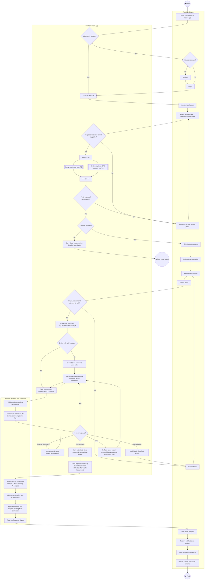
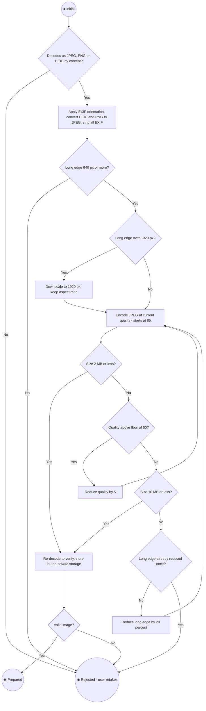
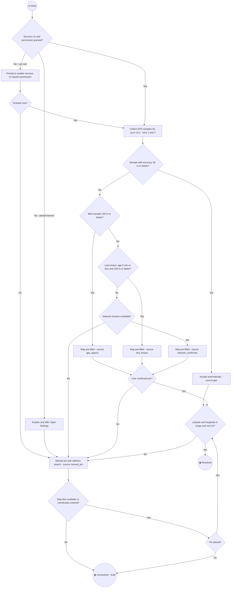
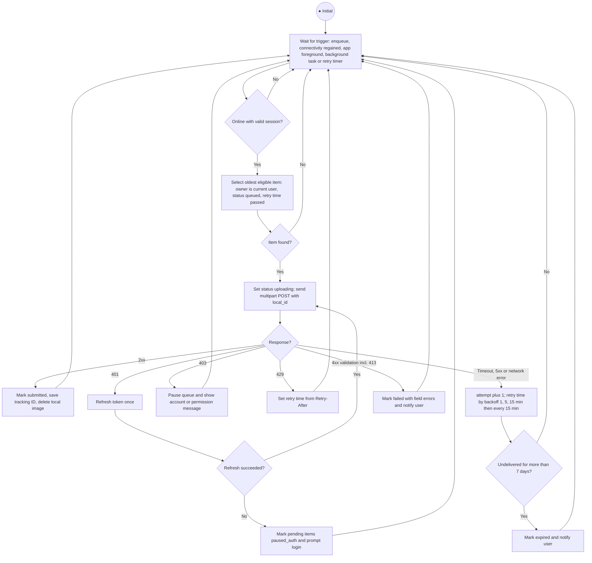
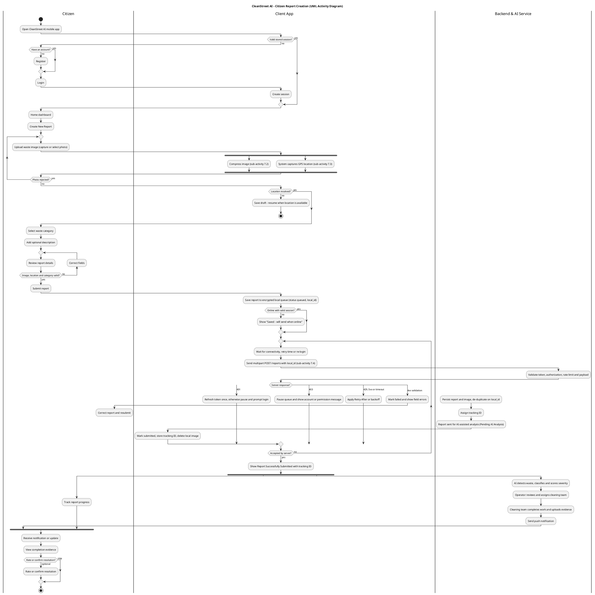

# Citizen Mobile App Client Architecture & UML Activity Diagram
### CleanStreet AI — Citizen Flutter Application

**Repository path:** `docs/design/mobile/citizen-app-architecture.md`

**UML Activity Diagram:** Section 7 — the rendered diagram is embedded in this file (7.0), with a step-by-step description (7.0), the PlantUML source (7.5) and GitHub-rendered Mermaid versions (7.1–7.4). This file is self-contained; no separate image files are needed.

**Scope:** Architecture of the Citizen Flutter application — client-side image compression pipeline, geolocation GPS fallback algorithm, offline report queueing (SQLite/Hive), and a formal UML Activity Diagram of the citizen report-creation sequence.

**Related documents:** Citizen Functions (functions 1–15), Availability & Reliability Requirements, API Protection and Rate Limiting Requirements, Field Cleaning-Team Mobile Architecture.

---

## 0. Source and Gap Note

The proposal establishes: Flutter as the proposed mobile technology (Section 14); the citizen report inputs — photo, GPS location, category, optional description (Sections 2, 6, 10); the citizen workflow (Section 16.1, Figure 6); the `REPORTS` and `IMAGES` tables (Section 15.2); Firebase Authentication and Firebase Cloud Messaging as candidate services (Section 13); and data minimization and image-privacy principles (Sections 17, 19).

The Figma material available is the System Workflow page: the **Citizen / User Workflow** (4.1, Figure 6 in the proposal), the Operator Workflow (4.2) and AI-Assisted Decision Support (4.3). This document follows the Citizen workflow's node names and order exactly — Open app → *Have an account?* → Register → Login → Home Dashboard → Create New Report → Upload Waste Image → System Captures GPS Location → Select Waste Category → Add Optional Description → Review Report Details → Submit Report → Report Successfully Submitted → Track Report Progress → Received Notification / Updates → View Completion Evidence → Rate / Confirm Resolution (Optional). No screen-level UI designs were provided, so the screen list in Section 3 is derived from those workflow nodes rather than from visual layouts. Section 13 lists every proposal and Figma item this design relies on.

The proposal does **not** specify: an image compression pipeline, a geolocation fallback strategy, an offline queueing mechanism, a local storage technology, or a client state-management approach. All of those are **proposed implementation requirements** in this document. They are marked *(proposed)* where a specific value or technology is chosen.

---

## 1. Architectural Overview

The app uses a layered structure so that the three hard problems — image processing, location resolution, and offline delivery — are isolated from the UI and independently testable.

| Layer | Responsibility | Key components |
|---|---|---|
| **Presentation** | Screens, form state, user feedback | Report wizard screens, Report History, Report Detail, notification handling |
| **Domain** | Business rules, independent of Flutter and I/O | `CreateReportUseCase`, `ProcessImageUseCase`, `ResolveLocationUseCase`, `EnqueueReportUseCase`, `ReportValidator` |
| **Data** | Persistence and network access behind repository interfaces | `ReportRepository`, `LocalReportStore` (SQLite), `RemoteReportApi` (REST), `ImageProcessor`, `LocationService`, `AuthSession` |
| **Sync engine** | Background delivery of queued reports | `SyncWorker`, `ConnectivityMonitor`, retry scheduler |

**Proposed technology choices** (all replaceable behind the repository interfaces):

| Concern | Proposed choice |
|---|---|
| State management | Riverpod or Bloc (one adopted project-wide) |
| Camera / gallery | `image_picker` (or `camera` for in-app capture) |
| Compression | `flutter_image_compress` (native encoders, EXIF handling) |
| Location | `geolocator` + `permission_handler` |
| Connectivity | `connectivity_plus` |
| Local database | SQLite via `drift` or `sqflite` (see Section 6.1) |
| Background execution | `workmanager` (Android WorkManager / iOS BGTaskScheduler) |
| Auth / push | `firebase_auth`, `firebase_messaging` (per Section 13) |
| HTTP | `dio` with an interceptor attaching the signed bearer token |

**Design principle:** the report wizard never talks to the network directly. It always writes to the local store through `EnqueueReportUseCase`, and the sync engine is the only component that sends reports to the backend. This makes online and offline submission the **same code path** — online simply means the sync engine fires immediately.

---

## 2. Authentication and Session (Client Side)

- Login, registration, and password reset use Firebase Authentication (if adopted per Section 13) or the project's chosen auth provider, as defined in Citizen Functions 1–4.
- The HTTP client attaches the signed token as `Authorization: Bearer <token>` on every request, per the API Protection requirements. Tokens are stored in platform secure storage (Keychain / Keystore), never in plain preferences.
- A `401` response triggers **at most one** silent token refresh and retry of the same request. If refresh fails, the session is marked expired, queued items move to `paused_auth`, sync pauses, and the user is routed to login. **Queued reports are preserved**, keep their original idempotency key, and resume after re-authentication.
- A `403` is an authorization or account-state failure (for example a disabled account), **not** an expired token. It is never answered with a refresh loop; the queue pauses and the user sees an explanatory message.
- Each queued report is stamped with the `user_id` that created it. The sync engine only sends items belonging to the currently authenticated user, so a second account on the same device can never submit another user's queued report.

---

## 3. Screens (Derived from Figure 6)

| Screen | Figma node(s) — Figure 6 step | Notes |
|---|---|---|
| Splash / session check | Open CleanStreet AI Mobile Application — 1 | Restores a stored session and routes to Home, or to the account decision |
| Account decision, Register, Login, Reset | *Have an account?* → Register → Login — 2–3 | As drawn in Figure 6, Register leads into Login. Citizen Functions 1–4 |
| Home dashboard | Home Dashboard — 3 | Entry point; shows recent reports and a queued-item banner |
| Report wizard: Photo | Create New Report, Upload Waste Image — 4–5 | Mandatory; triggers the compression pipeline. MVP supports one required photo (Section 6.6 covers the multi-image extension) |
| Report wizard: Location | System Captures GPS Location — 5 | Automatic capture; runs the fallback algorithm and asks for map confirmation only when needed |
| Report wizard: Category | Select Waste Category — 5 | Required; list from `CATEGORIES` |
| Report wizard: Description | Add Optional Description — 5 | Optional; maximum 500 characters *(proposed, per Citizen Functions, Function 9)* |
| Review & Submit | Review Report Details, Submit Report — 6 | Summary of all inputs; submit enabled only when valid. Submitting sends the report for AI-assisted analysis (the Figure 6 side note) |
| Submission result | Report Successfully Submitted — 6 | Shows the server tracking ID, or a "queued" state when offline |
| Report History / Detail | Track Report Progress — 8 | Reads server data with a local cache for offline viewing; shows the visible status feedback the proposal calls the primary adoption lever (acknowledged / in progress / resolved, Section 19) |
| Notifications | Received Notification / Updates — 8 | Push via FCM; deep-links to Report Detail |
| Completion evidence & confirm | View Completion Evidence; Rate / Confirm Resolution (Optional) — 9 | Showing real cleanup evidence is the adoption mechanism named in Section 16.1; confirmation is optional |

The citizen app does not show operator-side content (priority score, hotspot checks, team assignment). Those belong to the Operator workflow (4.2) and stay on the operations dashboard.

---

## 4. Image Compression Pipeline

**Why compress on the client:** field photos from modern phones are commonly 3–12 MB. Uploading them over weak mobile connections is slow and failure-prone, and the backend enforces a size ceiling (Citizen Functions, Function 6: JPEG/PNG, e.g. 10 MB maximum). Compression must reduce size **without** degrading the visual detail the YOLOv8 detection model relies on (Section 11) — small litter objects are the hardest case.

### 4.1 Pipeline stages

```
Capture/Select → Validate → Normalize → Resize → Compress (adaptive) → Verify → Store locally
```

| Stage | Behavior |
|---|---|
| **1. Capture / select** | Camera capture or gallery pick. The original file is read once. |
| **2. Validate** | Confirm the file decodes as a real image (by content, not extension). Accepted inputs: JPEG, PNG, HEIC/HEIF. Reject anything else with a clear message. |
| **3. Normalize** | Apply EXIF orientation so the pixels are upright. Convert HEIC and PNG to JPEG. **Strip all EXIF metadata** (including embedded GPS), because location is captured separately and explicitly, and stripping supports the proposal's privacy principle (Section 17). If a trustworthy capture time is available from the picker or capture flow it is sent as a separate optional `captured_at` value; the pipeline never depends on EXIF after stripping it, and device time is treated as untrusted input. |
| **4. Resize** | If the long edge exceeds **1920 px** *(proposed)*, downscale preserving aspect ratio. Never upscale. |
| **5. Compress (adaptive)** | Encode as JPEG starting at quality **85** *(proposed)*. If the result exceeds the **target size of 2 MB** *(proposed)*, reduce quality in steps of 5 down to a floor of **60**. |
| **6. Verify** | Re-decode the output to confirm it is valid. Check final size ≤ the backend hard limit (10 MB). If still over (pathological input), reduce the long edge by 20% and repeat once; if it still fails, ask the user to retake. |
| **7. Store locally** | Write the compressed JPEG to a temporary app-private file, verify it, then atomically rename it into its final path **before** committing the queue row. If file creation or the database transaction fails, delete the orphaned temporary or final file. The queue record references only the final path. The original is not retained by the app. |

### 4.2 Rules and thresholds

| Rule | Value | Rationale |
|---|---|---|
| Max long edge | 1920 px *(proposed)* | Enough resolution for small-object detection; large savings vs. 12 MP originals |
| Minimum acceptable long edge | 640 px *(proposed)* | Below this, detection quality is unreliable — user is warned and asked to retake |
| Initial JPEG quality / floor | 85 / 60 *(proposed)* | Floor prevents compression artifacts that would hurt classification |
| Soft target size | 2 MB *(proposed)* | Fast upload on weak connections |
| Hard limit | 10 MB | Matches the backend validation in Citizen Functions, Function 6 |

### 4.3 Execution and UX
- CPU-heavy decoding and resizing run off the UI isolate where the chosen plugin supports it; native plugins may instead use native worker threads. Responsiveness is verified on target devices rather than assumed for every plugin call.
- The user sees a thumbnail and a short "Preparing photo…" indicator; the Next button is disabled until the pipeline succeeds.
- Failures (corrupt file, unsupported format, too small) return specific error messages and keep the user on the Photo step — no other entered data is lost.
- **Out of scope for the client:** face and licence-plate blurring. The proposal lists blurring as a privacy mitigation "where feasible" (Section 19); it is treated as a server-side processing step, not a client responsibility.

---

## 5. Geolocation GPS Fallback Algorithm

**Goal:** always end with either a trustworthy coordinate or an explicit user-confirmed one — never a silent bad one. Location is mandatory (Citizen Functions, Function 7): a report cannot be submitted without valid coordinates.

### 5.1 Permission and service pre-checks

```
if location services disabled      → prompt to enable; offer manual pin (Tier 5)
if permission == denied            → request permission once
if permission == deniedForever     → explain; offer "Open Settings" and manual pin (Tier 5)
else                               → proceed to Tier 1
```

### 5.2 Fallback tiers

| Tier | Source | Accept condition | Result handling |
|---|---|---|---|
| **1** | High-accuracy GPS fix, **10 s timeout** *(proposed)* | Accuracy ≤ **50 m** *(proposed)* | Accepted automatically; `location_source = gps` |
| **2** | Best sample received during the Tier 1 window | Accuracy ≤ **150 m** *(proposed)* | Pre-filled on a map; user must confirm or adjust; `gps_approx` |
| **3** | Last known device location | Age ≤ **5 min** and accuracy ≤ 150 m *(proposed)* | Pre-filled on map; user must confirm; `last_known` |
| **4** | Network/coarse location (cell/Wi-Fi) | Any (typically hundreds of metres) | **Never auto-accepted.** Pre-fills the map as a starting point; user must place or confirm the pin; `network_confirmed` |
| **5** | Manual pin on map (with address search) | User explicitly places pin | `manual_pin` |
| **Fail** | None available | — | Submit blocked; draft can still be saved |

### 5.3 Algorithm

```
function resolveLocation():
    precheckPermissionsAndServices()          # Section 5.1
    best = null

    # Tier 1 + 2: collect samples for up to 10 s
    for sample in gpsStream(timeout = 10s):
        if best == null or sample.accuracy < best.accuracy: best = sample
        if sample.accuracy <= 50: return Accept(sample, source = "gps")

    if best != null and best.accuracy <= 150:
        return ConfirmOnMap(best, source = "gps_approx")

    # Tier 3
    last = getLastKnown()
    if last != null and age(last) <= 5min and last.accuracy <= 150:
        return ConfirmOnMap(last, source = "last_known")

    # Tier 4
    coarse = getNetworkLocation()
    if coarse != null:
        return ConfirmOnMap(coarse, source = "network_confirmed")   # user must adjust/confirm

    # Tier 5
    return ManualPin()                                              # mandatory user action
```

All returned coordinates are validated before use: latitude within −90…90, longitude within −180…180, and not the exact (0, 0) "null island" default.

### 5.4 Behavioral rules
- **Accuracy and source are stored with the report** (`location_accuracy_m`, `location_source`) so operators can see how reliable a location is. These are proposed additions to the `REPORTS` table (see Section 9).
- **Freshness:** location is captured when the photo is taken. At the Review step, if the stored fix is older than **2 minutes** or the user has moved (a fresh fix differs by more than **100 m**) *(proposed)*, the app re-runs resolution before allowing submit.
- **Offline behavior:** GPS works without a data connection, so Tiers 1–3 are unaffected by being offline. Tier 5 (map) needs map tiles; if offline with no cached tiles, the app lets the user enter the report as a **draft** and complete the pin later when online rather than forcing a bad coordinate.
- Non-Tier-1 results always show a map confirmation so the user sees and owns the final position.

---

## 6. Offline Report Queueing

Because online submission also goes through the queue (Section 1), offline support is not a special mode — it is the normal architecture.

### 6.1 Storage choice: SQLite over Hive *(proposed)*

| Criterion | SQLite (`drift`/`sqflite`) | Hive |
|---|---|---|
| Relational queries (by status, by user, ordered by time) | Native | Manual filtering |
| Transactions (atomic enqueue of record + image reference) | Yes | Limited |
| Schema migrations | Mature tooling | Manual |
| Queue semantics (ordering, retry timestamps) | Straightforward | Awkward |
| Fit for report-history cache | Good | Adequate |

**Decision:** SQLite for the report queue and history cache. Hive is acceptable for small key-value settings (e.g., onboarding flags) but is not used for queue data. Because the queue stores location data and photo references, the database uses an **explicitly encrypted** SQLite implementation (for example SQLCipher) with its key held in platform secure storage *(proposed)*. Plain `sqflite` or `drift` alone does not imply encryption at rest. Photo files are protected separately: they live in app-private storage and, if the threat model requires encryption at rest, are encrypted with a key held in secure storage.

### 6.2 Local queue schema *(proposed)*

| Column | Purpose |
|---|---|
| `local_id` (UUID v4, PK) | Doubles as the **idempotency key** sent to the server |
| `user_id` | Owner; only this user's session may sync the item |
| `category_id`, `description` | Report fields |
| `latitude`, `longitude`, `location_accuracy_m`, `location_source` | Location result (Section 5) |
| `image_path` | Path to the compressed JPEG in app-private storage |
| `captured_at` | Capture time from the picker or camera when trustworthy; informational only, never used for ordering |
| `status` | `draft` · `queued` · `uploading` · `paused_auth` · `submitted` · `failed` · `expired` |
| `attempt_count`, `next_retry_at`, `last_error` | Retry bookkeeping |
| `server_report_id` / `tracking_id` | Filled in after the server accepts the report |
| `created_at`, `updated_at` | Auditing |

### 6.3 Queue item lifecycle

```
draft ──(user submits)──► queued ──(sync picks up)──► uploading ──(2xx)──► submitted
                             ▲                            │
                             │                            ├─(timeout / 5xx / no network)─► queued  (attempt++, backoff)
                             │                            ├─(429)──► queued (wait Retry-After)
                             │                            ├─(401, refresh fails)──► paused_auth ──(re-login)──► queued
                             │                            ├─(403)──► queue paused, message shown (no refresh loop)
                             │                            └─(4xx validation, incl. 413)──► failed ──(user edits)──► draft
                             └──────────── (TTL exceeded) ───────────────────────────► expired
```

A `403` is an authorization or account-state failure, not a refreshable token expiry. A `413` or other image-validation error is shown with actionable guidance (for example "retake a smaller photo") rather than a generic failure.

### 6.4 Sync engine behavior
- **Triggers:** immediately after enqueue; on connectivity regained; on app foreground; and via a periodic background task (WorkManager / BGTaskScheduler).
- **One atomic request per report:** a single multipart `POST /reports` carrying the fields, the image, and the `local_id` idempotency key. This avoids orphaned images or half-created reports that a two-step upload would risk, and keeps retries simple. (Resumable chunked upload is out of scope; the compressed image is typically ~2 MB.)
- **Idempotency:** the server de-duplicates on `local_id` (stored as `client_report_id`). For a duplicate it returns the **original** success response (same report and tracking ID) rather than an error, so the client treats a replayed request as a normal success and a lost response never creates a duplicate report.
- **Crash recovery:** on every app launch, items left in `uploading` for more than 2 minutes are reset to `queued`. Combined with idempotency, a crash or kill mid-upload cannot lose or duplicate a report.
- **Double-tap protection:** `local_id` is generated when the wizard starts, and the Submit button is disabled after the first tap, so repeated taps resolve to a single queue record.
- **Ordering:** FIFO per user, one upload at a time (avoids saturating weak connections).
- **Backoff for transient failures:** reuse the project's established pattern — 1 → 5 → 15 minutes, then every 15 minutes — as a starting point *(proposed; adjustable after field testing)*.
- **Rate-limit awareness:** the effective quota is whatever the API Protection and Rate Limiting Requirements currently specify; this document deliberately does not repeat the number, so the two cannot drift apart. On `429`, the engine honors `Retry-After`; when flushing a backlog it paces requests rather than bursting.
- **Permanent failures:** a `400`/validation error (including `413`) moves the item to `failed` with the server's field-level message; the user is notified and can edit and resubmit. A `401` that cannot be refreshed moves items to `paused_auth`, and a `403` pauses the queue (Section 2). Items are never silently dropped.
- **Expiry:** items that cannot be delivered for **7 days** *(proposed)* become `expired` and the user is notified. They are not silently deleted: enough local data is kept for the citizen to see why delivery failed and to choose to retry or discard. The TTL and the discard action are explicit product policy (Section 12).
- **Cleanup:** after a `submitted` result, the local compressed image is deleted; the history row remains as a cache.

### 6.5 User-facing behavior
- Submitting offline shows a confirmation such as **"Saved — will send when you're back online"** with a visible queued badge on Home and in History.
- **Tracking ID nuance:** the tracking ID is assigned by the server (Citizen Functions, Function 5). Offline, the app shows a local reference and a "Pending" state; the real tracking ID appears once sync succeeds. This is the one deliberate exception to "tracking ID shown immediately on submit."
- Queued items can be viewed and, while still `queued`, cancelled by the user.
- Report History and Detail screens cache the last successfully fetched data in SQLite so previously submitted reports remain viewable offline.
- **Storage guardrail:** a cap of **20 queued items** *(proposed)*; beyond that the user is asked to connect before creating more.
- **Logout with pending items:** the app warns that unsent reports exist; items remain stored (encrypted) and tied to their owner.

### 6.6 Edge Cases and Failure Handling

| Case | Handling |
|---|---|
| App killed or crashed mid-upload | Stale `uploading` items reset to `queued` on next launch; idempotency prevents duplicates (Section 6.4) |
| Phone storage nearly full | Free space is checked before compression and enqueue (proposed minimum 50 MB); if insufficient, the user gets a clear message and nothing is half-saved |
| Original photo deleted from the gallery after selection | No effect — the app keeps only its own compressed copy in private storage |
| Device clock is wrong | `captured_at` is informational only. The server's own receive time is authoritative, queue ordering uses a local sequence number rather than wall-clock time, and the server clamps future timestamps |
| Session expires while offline for days | Queue is preserved; after re-login the sync engine resumes. Items owned by a different account are untouched |
| Account disabled or password reset (403 / persistent 401) | Queue pauses and the user is told why; no items are discarded |
| Category removed server-side after the item was queued | Server returns a validation error; item moves to `failed`, the user reselects a category and resubmits. The `CATEGORIES` list is refreshed on every launch |
| Location permission revoked while a draft is open | Location resolution re-runs at the Review step (Section 5.4) |
| Backend unavailable | Treated as a transient failure — backoff and retry. AI-service downtime has **no client effect**: the report is accepted and shows "Pending AI Analysis" (Availability & Reliability Requirements) |
| iOS background execution limits | Background tasks are best-effort and not guaranteed. Foreground and connectivity-regained triggers are therefore essential, and the app shows a reminder if queued items stay undelivered for more than 24 hours |
| Data saver / metered network | Syncing respects OS network constraints; an optional "Wi-Fi only" upload setting is an open decision (Section 12) |
| Multiple images per report | The proposal's `IMAGES` table allows several images per report, but the MVP requires exactly one photo. Extending to several (proposed maximum of 5) needs a child table for queued images and a repeated pipeline run per image |

---

## 7. UML Activity Diagram — Citizen Report Creation

This section gives the citizen reporting sequence in two forms:

- **Formal UML source (Section 7.5):** a PlantUML activity diagram with three swimlanes (Citizen, Client App, Backend & AI Service), a fork/join, loops, and a response switch. It is the canonical diagram. GitHub does not render PlantUML natively, so the rendered diagram is embedded in this file as an image (Section 7.0; the image data sits at the very end of the file).
- **Mermaid diagrams (Sections 7.1–7.4):** render directly on GitHub. 7.1 is the main activity; 7.2–7.4 expand its three call-behavior nodes.

Both forms use UML activity notation (initial node ●, final nodes ◉, decision diamonds with guards, fork/join bars, partitions) and the Figure 6 node names. They map to Figure 6, steps 1–9.

### 7.0 UML Activity Diagram — rendered, and in words

![UML Activity Diagram — Citizen Report Creation][report-activity-diagram]

*Formal UML activity diagram with three swimlanes (Citizen, Client App, Backend & AI Service), rendered from the PlantUML source in Section 7.5. If your viewer does not display embedded images, use the numbered flow below or the Mermaid diagram in 7.1.*

**The same diagram as a numbered flow** (each decision, loop, fork and final node in order):

1. **Citizen:** opens the CleanStreet AI mobile app. **Client App — decision:** valid stored session? *Yes* → Home. *No* → **Citizen — decision:** have an account? *No* → Register; then Login. The Client App creates a session.
2. **Citizen:** Home Dashboard → Create New Report.
3. **Loop — repeat while the photo is rejected.** **Citizen:** uploads a waste image (capture or select). **Client App — fork, in parallel:** (a) compress the image (validate, normalize, strip EXIF, resize, compress, verify) and (b) capture the GPS location (fallback tiers 1–5). *Join* when both finish.
4. **Client App — decision:** location resolved? *No* → save a draft to resume later → **Final node (draft saved).** *Yes* → continue.
5. **Citizen:** selects the waste category and adds an optional description. **Loop — review report details**, returning to "Correct fields" until the image, location and category are all valid.
6. **Citizen:** submits the report. **Client App:** saves it to the encrypted local queue (status `queued`, with a `local_id`). **Decision:** online with a valid session? *No* → shows "Saved — will send when online".
7. **Loop — until the server accepts the report.** The Client App waits for connectivity, a retry time or re-login, then sends a multipart `POST /reports` with the `local_id`. **Backend:** validates the token, authorization, rate limit and payload. **Switch on the response:**
   - **2xx accepted:** the backend stores the report and image, de-duplicates on `local_id`, assigns the tracking ID and sends the report for AI-assisted analysis (Pending AI Analysis). The Client App marks it submitted, stores the tracking ID and deletes the local image.
   - **401:** refresh the token once; otherwise pause and prompt login.
   - **403:** pause the queue and show an account or permission message.
   - **429, 5xx or timeout:** apply `Retry-After` or backoff, then loop.
   - **4xx validation:** mark failed and show field errors. **Citizen:** corrects the report and resubmits; only then does the loop send again.
8. **Client App:** shows Report Successfully Submitted with the tracking ID.
9. **Fork, in parallel.** **Backend:** the AI detects waste, classifies it and scores severity; an operator reviews and assigns a cleaning team; the team completes the work and uploads evidence; a push notification is sent. **Citizen:** tracks report progress. *Join.*
10. **Citizen:** receives the notification or update and views the completion evidence. **Decision:** rate or confirm resolution? *Optional* → confirm. **Final node.**

### 7.1 Main activity — report creation (Mermaid)



**Reading notes**
- **Account decision:** Figure 6 asks *Have an account?* and routes No → Register → Login. A stored-session check comes first (an engineering addition) so returning users skip straight to Home.
- **Fork/Join:** image compression and GPS capture run in parallel after a valid image is selected, because location acquisition (up to 10 s) would otherwise sit idle behind compression. Both must finish before the flow continues.
- **Two final nodes:** the normal path ends after the citizen has tracked the report to completion. The alternative ends with "draft saved" when no location could be resolved (for example offline with no cached map tiles). The draft is kept, not lost.
- **Queued path:** the report is stored before any network call. Offline, the citizen sees "Saved — will send when online" once, and the flow then waits on events (connectivity, timer, foreground) instead of blocking.
- **Server lane:** `B1`/`B2` are drawn on the success path for readability. A rejection at `B1` (bad token, rate limit, invalid payload) surfaces through the response decision as 401, 403, 429 or 4xx.
- **AI is asynchronous:** `B3`/`B4` happen *after* acceptance, so the citizen never waits for analysis. If the AI service is down the report stays "Pending AI Analysis" (Availability & Reliability Requirements).
- **Time scale:** `B5`–`C12` can occur hours or days after submission. They are drawn in one flow to show the full Figure 6 sequence, not to imply the citizen waits.

### 7.2 Sub-activity — image compression pipeline (node A5)



### 7.3 Sub-activity — location resolution with GPS fallback (node A6)



### 7.4 Sub-activity — sync engine (node A15)

The sync engine is a long-running background activity with **no final node**: it loops on triggers for as long as the app is installed.



### 7.5 Formal UML activity diagram (PlantUML source)



**How it differs from the Mermaid diagrams:** it models the post-submission phase as a fork — the backend chain (AI analysis → operator review and assignment → cleaning and evidence → push notification) runs concurrently with the citizen tracking progress — and it keeps the delivery loop as one `repeat … while (Accepted by server?)` with a response `switch`. A validation failure sends the citizen to "Correct report and resubmit" *before* the loop sends again, so a failed item is never resent automatically.

### 7.6 Mapping to Figure 6

| Figure 6 step | Diagram 7.1 nodes |
|---|---|
| 1. Open app | `C1`, `A1` |
| 2. Register if no account | `AH`, `AR` |
| 3. Login, home dashboard | `AL`, `A1`, `A3` |
| 4. Create new report | `C2` |
| 5. Provide image, location, category, description | `C3`, `A4`–`A9` (with `A5` = 7.2 and `A6` = 7.3), `C4`, `C5` |
| 6. Review and submit | `C6`, `C7`, `A10`–`A21` (with `A15` = 7.4) |
| 7. System analyses report using AI | `B3`, `B4` |
| 8. Track report and receive updates | `B6`, `C10`, `C10B` |
| 9. View completion evidence and rate / confirm resolution | `C11`, `C12` |

---

## 8. Security and Privacy Considerations (Client)

- Tokens in Keychain/Keystore; all traffic over HTTPS; the signed-token and rate-limit behavior follows the API Protection requirements.
- The local queue database is encrypted; compressed images live in app-private storage and are deleted after a successful submit.
- EXIF metadata, including embedded GPS, is stripped from every image before it is stored or sent (Section 4.1).
- Location is collected **only** when the user is creating a report — there is no background location tracking in the citizen app. This is consistent with data minimization (Section 17) and deliberately contrasts with the assignment-scoped tracking in the field cleaning-team app.
- Any mapping SDK key embedded in the app is a platform-restricted client key and is never the backend service-role key.
- Queued items are bound to their owner's `user_id` and are never sent under a different authenticated user.

---

## 9. Proposed Data Model Extensions

| Table | Proposed new field(s) | Purpose |
|---|---|---|
| `REPORTS` | `location_source`, `location_accuracy_m` | Let operators judge how reliable a coordinate is |
| `REPORTS` | `client_report_id` (unique) | Server-side idempotency / de-duplication of retried submissions |
| `REPORTS` | `captured_at` | Preserve the device capture time separately from server `created_at`, since offline reports are created server-side later |

---

## 10. Non-Functional Targets, Localization and Accessibility *(all proposed)*

| Target | Value | Notes |
|---|---|---|
| Photo preparation time | ≤ 3 s at the 95th percentile for a 12 MP photo on a reference mid-range Android device | The reference device is to be named by the team before testing |
| Location Tier 1 wait | ≤ 10 s before the fallback UI appears | Section 5.2 |
| Enqueue latency | ≤ 500 ms from tapping Submit to the "saved" confirmation | Submission never waits on the network |
| UI responsiveness | No dropped-frame jank during compression or sync | Work runs in isolates / background workers |
| Background battery cost | No location polling outside the report wizard; sync only on triggers | See Section 8 |

**Localization:** user-facing strings are externalized from the start so a second language can be added without code changes. Whether the app ships in Arabic and English, with right-to-left layout support, is an open decision (Section 12); the proposal does not state a language requirement.

**Accessibility:** interactive controls meet a 48 dp minimum touch target, all images and icons carry semantic labels for screen readers, and status (queued, failed, submitted) is never conveyed by colour alone.

---

## 11. Testing and Verification

| Area | Approach |
|---|---|
| Image pipeline | Unit tests with fixture images: 12 MP JPEG, HEIC, PNG, tiny (< 640 px), corrupt file, EXIF-rotated, and a file with embedded GPS EXIF. Assert dimensions, size limits, quality floor, and that output contains no EXIF. Fault-injection test: fail the file write and the database commit separately and assert no orphaned file or queue row remains |
| Location resolution | Unit tests with mocked sample streams for every tier and for each permission state (granted, denied, denied-forever, services off); assert tier order, thresholds, and the 0,0 and out-of-range rejections |
| Queue and sync | Unit tests with a fake clock and a fake API covering 2xx, duplicate replay, 401 with refresh success and failure, 403 (no refresh loop), 429 with `Retry-After`, 5xx, timeout, 413, and 4xx validation. Crash-recovery test that kills the process mid-upload |
| Offline integration | On real devices: create a report in airplane mode, restore connectivity, and verify exactly one report arrives with the correct fields |
| Security | Inspect uploaded bytes for EXIF GPS; confirm the local database file is not readable as plain SQLite; confirm tokens never appear in logs |
| Device matrix | Low-end and mid-range Android; iOS if it is in MVP scope (Section 12) |
| Diagram review | Walk Figure 6 step by step against diagrams 7.1–7.5; confirm the Mermaid blocks and the PlantUML source each render without syntax errors, and that the embedded image still matches the PlantUML source |

---

## 12. Open Decisions

These items need a team decision; the document uses the stated default until then.

| # | Decision | Default used here |
|---|---|---|
| 1 | State-management library (Riverpod or Bloc) | Either; adopt one project-wide |
| 2 | SQLite library (`drift` or `sqflite`) and encryption approach (SQLCipher) | `drift` + SQLCipher |
| 3 | Map provider and offline tile strategy (Google Maps or OpenStreetMap) | Undecided; affects offline manual pin |
| 4 | Is iOS in MVP scope? The proposal allows "Flutter, or a native Android implementation" | Cross-platform, with iOS background limits handled by foreground triggers |
| 5 | Approve the offline exception to "tracking ID shown immediately on submit" | "Pending" local reference until the server assigns the ID |
| 6 | Approve the proposed `REPORTS` additions (Section 9) | Approved for design purposes |
| 7 | Languages and right-to-left support | English only until decided |
| 8 | Multiple photos per report in MVP | One photo |
| 9 | Default for the "Wi-Fi only" upload setting | Off |
| 10 | Who regenerates the embedded diagram image | Re-render and re-embed it whenever Section 7.5 changes |

---

## 13. Compatibility with the Proposal and Figma Design

| Proposal / Figma item | Where addressed | Basis |
|---|---|---|
| Flutter as the mobile technology (Section 14) | Section 1 | Direct |
| Report inputs: photo, GPS, category, optional description (Sections 2, 6, 10; Figure 6 step 5) | Sections 3, 4, 5 | Direct |
| Citizen workflow, all nine steps (Section 16.1, Figure 6) | Section 7 (7.1–7.6) | Direct |
| Registration and login; Firebase Authentication as a candidate (Sections 9, 13) | Section 2 | Direct |
| Push notifications; Firebase Cloud Messaging as a candidate (Sections 9, 13) | Section 3 (Notifications) | Direct |
| Status tracking and history of submitted reports (Section 10) | Sections 3, 6.5 | Direct |
| Completion evidence and optional confirmation (Figure 6 step 9; Section 16.1) | Section 3, diagrams 7.1 and 7.5 | Direct |
| `REPORTS`, `IMAGES`, `CATEGORIES` schema (Section 15.2) | Sections 6.2, 9 | Direct, plus four proposed `REPORTS` fields (an extension) |
| AI analysis runs after the report is stored, written back to the report (Section 15.1, Figure 4) | Diagram 7.1 (`B3`, `B4`) | Direct |
| "AI assists, operator decides"; operator-side content stays off the citizen app (Sections 16.2, 16.3) | Section 3 | Direct |
| Data minimization and image privacy (Sections 17, 19) | Sections 4.1, 8 | Direct principle |
| Out of scope respected: no physical collection, no real-time worker tracking, no routing in the citizen app (Sections 9, 19) | Section 8 | Direct |
| Image compression, GPS fallback tiers, offline queue, SQLite storage | Sections 4, 5, 6 | **Extension** — not specified in the proposal |

---

## 14. Acceptance Conditions

| ID | Requirement | Acceptance Condition |
|---|---|---|
| AC-01 | Mandatory image | The wizard cannot proceed past the Photo step without a valid, decodable image. |
| AC-02 | Compression size | For representative 12 MP test images the pipeline targets ≤ 2 MB while keeping quality at or above the floor; every accepted upload is ≤ 10 MB. The 2 MB figure is a target, not a guarantee for every image. |
| AC-03 | Detection-safe quality | Output long edge is ≤ 1920 px, JPEG quality is never below the floor of 60, and images under 640 px are rejected with a retake prompt. |
| AC-04 | Metadata stripping | Images stored and uploaded contain no EXIF GPS data. |
| AC-05 | Non-blocking processing | Compression does not freeze the UI; responsiveness is verified on the reference devices. |
| AC-06 | GPS tier order | Location resolution attempts tiers in the defined order and stops at the first acceptable result. |
| AC-07 | No silent poor location | Any location with accuracy worse than 50 m, or from network/last-known sources, requires explicit user map confirmation. |
| AC-08 | Permission handling | Denied, permanently denied, and disabled-services cases each lead to a defined path (prompt, settings, or manual pin) — never a crash or dead end. |
| AC-09 | Location recorded | Each report stores `location_source` and `location_accuracy_m`. |
| AC-10 | Offline submission | A report completed with no connectivity is saved locally and delivered automatically once connectivity returns, without user retyping. |
| AC-11 | No duplicates | A retried or replayed submission never creates a second report; the server returns the original success response. |
| AC-12 | Retry and rate limits | Transient failures retry with backoff; `429` responses honor `Retry-After`; a backlog flush stays within the quota defined in the API Protection and Rate Limiting Requirements. |
| AC-13 | No silent loss | Permanently failed or expired queue items are surfaced to the user, never silently discarded. |
| AC-14 | Tracking ID honesty | Offline items show a "Pending" local reference; the real tracking ID is displayed only after server acceptance. |
| AC-15 | Queue ownership | Queued reports are only sent under the authenticated user who created them. |
| AC-16 | Encrypted local data | The SQLite implementation is verified to encrypt at rest; photo-file protection is specified separately; local images are removed only after confirmed server acceptance. |
| AC-17 | Diagram completeness | The main activity diagram, its three sub-activity diagrams, and the formal PlantUML diagram cover every Figure 6 step (1–9), including the *Have an account?* decision and the offline, retry, 401, 403, and validation-failure branches, and all render without errors. |
| AC-18 | Crash recovery | A report in `uploading` when the app is killed is retried on next launch with no loss and no duplicate. |
| AC-19 | Double submit | Rapid repeated taps on Submit create exactly one queue record. |
| AC-20 | Storage guard | With insufficient free storage the app blocks enqueue with a clear message instead of failing midway. |
| AC-21 | Offline session expiry | If the token expires while the device is offline, queued reports stay stored and are delivered after re-login; none are lost. |
| AC-22 | Photo preparation time | A 12 MP photo is prepared within 3 s (95th percentile) on the reference mid-range device without UI jank. |
| AC-23 | Atomic image storage | Injected failures during file write or database commit leave no orphaned image file and no queue row without its image. |
| AC-24 | Auth failure handling | A `401` triggers at most one refresh per request and moves items to `paused_auth` if refresh fails; a `403` never triggers a refresh loop; queued reports survive both. |
| AC-25 | Figma conformance | The wizard and tracking flow reproduce the Figure 6 node order, with operator-only content absent from the citizen app. |

---

## Delivered Means

A citizen Flutter app architecture specification covering: a layered client architecture with a single queue-first submission path; a staged client-side image compression pipeline (validate, normalize, strip EXIF, resize, adaptive JPEG compression, verify) tuned to preserve detection quality; a five-tier geolocation fallback algorithm with explicit accept thresholds, permission handling, and stored accuracy and source; an offline report queue on encrypted SQLite with idempotent delivery, crash recovery, backoff, rate-limit awareness, and defined failure and expiry handling; edge-case, non-functional, testing, and open-decision sections; and a formal UML Activity Diagram (PlantUML source plus GitHub-rendering Mermaid versions), partitioned by Citizen / Client App / Backend & AI, mapping the full citizen reporting sequence in the exact node order of Figure 6 (steps 1–9), supported by three sub-activity diagrams for image compression, location resolution, and the sync engine, and a compatibility matrix tying every design element to the proposal or marking it as an extension.

---

## Source Note

The proposal establishes the citizen inputs (photo, GPS, category, optional description), Flutter as the proposed technology (Section 14), the citizen workflow (Figure 6), the `REPORTS`/`IMAGES` schema, Firebase Authentication and Cloud Messaging as candidate services, and the data-minimization and image-privacy principles (Sections 17 and 19).

It does **not** specify an image compression pipeline or any thresholds, a geolocation fallback strategy or accuracy values, an offline queueing design, a local storage technology, a state-management approach, performance targets, language requirements, or the proposed `REPORTS` field additions. All of these, including every numeric value marked *(proposed)*, are proposed implementation requirements that should be tuned after prototype and field testing. No screen-level Figma designs were available; screens are derived from the Figure 6 workflow nodes.

*End of document.*

<!-- Embedded diagram image for Section 7.0 (SVG, base64). Re-render from the PlantUML source in Section 7.5 if the diagram changes. -->
[report-activity-diagram]: 
