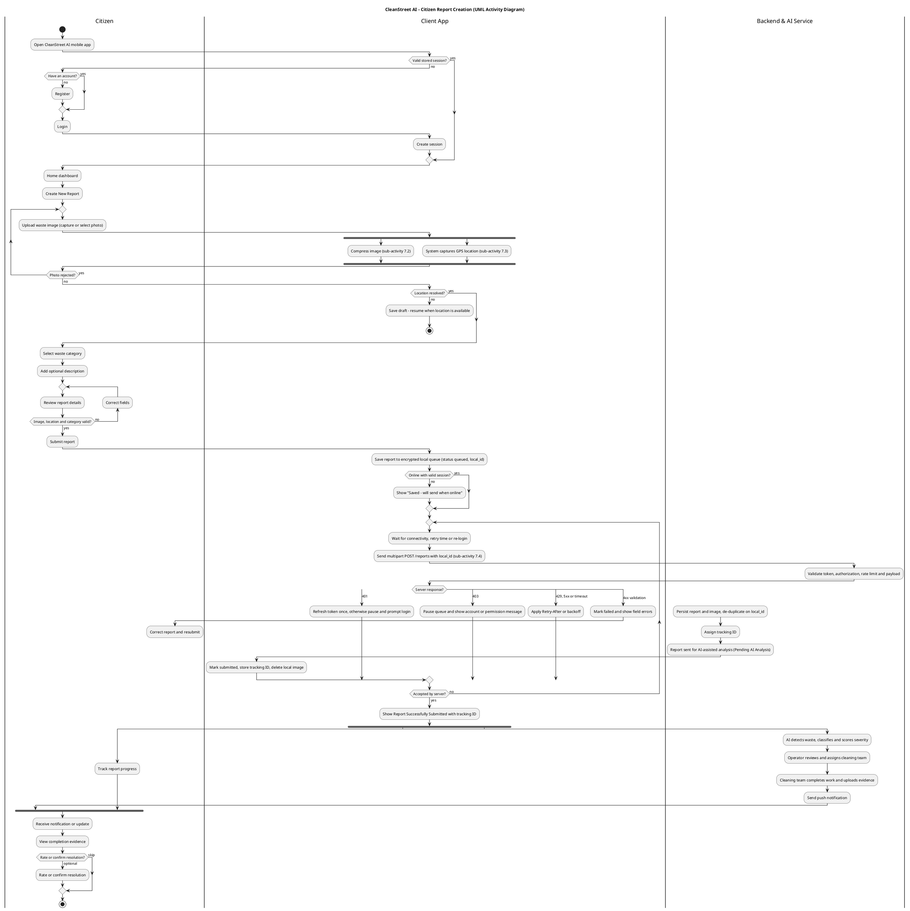
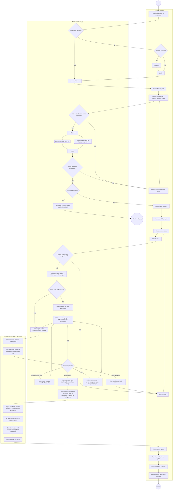

# CleanStreet AI — Requirements and Design Specification (Condensed)

**Project:** CleanStreet AI — A Smart Citizen-Requested Street Cleaning and Waste Management Platform
**Compiled:** 13 October 2026

Six deliverables in one short document. Each part keeps the decisions, formulas, tables and acceptance conditions of its full version and drops the long rationale. Anything not stated in the project proposal is a **proposed implementation requirement**. Numeric values are proposals to be tuned after prototype and pilot testing. Section numbers cited next to a proposal topic (for example "Section 14" for Flutter) refer to the proposal.

| Part | Document | Status |
|---|---|---|
| [1](#part-1) | Citizen Functions — Report Details & Tracking | Final |
| [2](#part-2) | Availability & Reliability Requirements | Final |
| [3](#part-3) | API Protection and Rate Limiting Requirements | Draft — pending ADR-007 and T_85ab37 |
| [4](#part-4) | Area Burden Score Requirements | Final |
| [5](#part-5) | Citizen Mobile App Architecture & UML Activity Diagram | Final |
| [6](#part-6) | Field Cleaning-Team Mobile Architecture & Geolocation | Final — pending T_85ab37 for the team-member role |

---

<a id="part-1"></a>

## Part 1 — Citizen Functions — Report Details & Tracking

**Scope:** every citizen-facing function, from account access to report creation, tracking and resolution, following the Citizen/User Workflow (Figure 6) and the `USERS`, `REPORTS`, `IMAGES`, `CATEGORIES`, `STATUS_HISTORY` tables (Section 15.2).

| # | Function | Description | Acceptance condition | Source |
|---|---|---|---|---|
| 1 | Citizen Registration | New citizen creates an account and accesses the system | A citizen without an account registers successfully and then accesses the system | Explicit (Scope; step 2) |
| 2 | Citizen Login | Registered citizen authenticates and reaches the dashboard | Valid credentials grant access; invalid ones are rejected | Explicit (step 3) |
| 3 | Session Management | Keeps the citizen authenticated and gates protected features | Authenticated users reach protected features; unauthenticated users cannot | Inferred (standard auth) |
| 4 | Password Reset | Recover access through the authentication mechanism | The citizen completes the reset and logs in with the new password | Inferred (standard auth) |
| 5 | Create Waste Report | Submit a report about waste, illegal dumping or an unclean area | Created when all required information is provided and valid | Explicit (Sections 9–10) |
| 6 | Mandatory Image Upload | Photographic evidence is required | Submission is blocked without an image | Explicit (Section 6) |
| 7 | Capture Location | GPS/location of the problem is captured | Submission is blocked without valid location | Explicit (Section 9) |
| 8 | Select Report Category | Citizen chooses the problem category | A valid category is stored and viewable later | Explicit (Section 9) |
| 9 | Add Report Description | Optional extra detail | Stored and shown with the report details | Explicit (Section 6) |
| 10 | Review & Submit Report | Review image, location, category, description, then submit | Submit works only when required information is valid | Explicit (step 6) |
| 11 | View Report Details | See image, location, category, description, status | Selecting a report shows its stored details correctly | Inferred (Section 10) |
| 12 | Track Report Status | Follow progress through the workflow | The citizen sees the current status and receives updates | Explicit (step 8) |
| 13 | View Completion Evidence | See the cleaning team's evidence | Evidence is displayed when available | Explicit (step 9) |
| 14 | Confirm Resolution | Confirm the issue is resolved after reviewing evidence | The citizen can confirm once evidence is available | Explicit (step 9, optional) |
| 15 | Report History | Access previously submitted reports | Reports are retrievable by the authenticated citizen | Explicit (Section 10) |

**Key rules behind the acceptance conditions**
- **Login:** a wrong email or password returns one generic error; repeated failures trigger a temporary lockout. Unverified or deactivated accounts get an explanatory message.
- **Sessions:** a token is required for every protected action. Sessions expire after inactivity or a maximum lifetime, and logout invalidates the session on the server.
- **Password reset:** single-use, time-limited link; identical response whether or not the account exists; all sessions end after a reset.
- **Image and location:** JPEG/PNG with a size limit (10 MB), validated by content. If GPS is denied, a manual map pin is offered.
- **Category and description:** category comes from the fixed `CATEGORIES` list; description is optional and escaped on display.
- **Ownership:** a citizen can open only their own reports. Submission stores `current_status = "Submitted"`, a timestamp and a unique tracking ID, then queues AI analysis without making the citizen wait.
- **Completion evidence:** stored as an `IMAGES` row (`image_type = "completion_evidence"`), visible only after the operator marks the step complete. Confirmation is optional and never blocks the operator.

**Dependencies:** functions 6, 7 and 8 are hard prerequisites for function 10 — image and location are the inputs to the AI analysis.

**Why 3 and 4 are included:** the proposal scopes registration and login but does not describe session handling or password recovery. They are included because login is unfinished without them; they trace to no specific proposal section.

---

<a id="part-2"></a>

## Part 2 — Availability & Reliability Requirements

**Scope:** uptime expectations for the Backend System and AI Service, and behavior when the AI service is down. The two are separate components (Section 15.1, Figure 4), so they get separate targets.

| Component | Proposed target | Purpose |
|---|---|---|
| Backend System | 99.5% monthly availability | Protects authentication, report submission, storage, tracking |
| AI Service | 99% monthly availability | Supports image analysis and prioritization without blocking the core workflow |
| AI recovery | 15-minute RTO | Resume queued AI processing after the service returns |

Planned maintenance is excluded from the calculation if scheduled ahead, announced at least 24 hours before, and done outside peak reporting periods. Availability is measured per component through a `/health` endpoint on each. **All of these values are proposals; the proposal sets no numeric uptime target.**

**Fallback when the AI service is unavailable.** Rule: AI downtime must not stop citizens from submitting or operators from managing reports.
- **Citizen:** submits normally, receives a tracking ID, sees the report in history. The report shows "Pending AI Analysis" and the citizen never resubmits. The manually chosen category is kept.
- **Backend:** analysis is a separate step, not a condition of acceptance. Pending reports are retried with backoff — 1 → 5 → 15 minutes, then every 15 minutes. No report or image is lost.
- **Operator:** pending reports are clearly marked. The operator can view, manually prioritize and assign them.
- **Recovery:** pending reports are processed, results are saved on the original report, and the citizen's tracking ID is unchanged. If an operator already decided, the late AI result is stored as extra decision support and never overwrites that decision.

| During AI downtime | Available | Unavailable |
|---|---|---|
| Citizen | registration/login, report creation, image upload, location, category, tracking | — |
| Operator | dashboard, manual review, manual assignment | AI analysis, AI priority scoring, duplicate detection, hotspot features |

**Acceptance conditions**

| Requirement | Acceptance condition |
|---|---|
| Backend and AI targets | ≥ 99.5% and ≥ 99% monthly availability documented and measured |
| Submission during AI outage | A citizen submits a report while the AI service is down |
| No data loss | Reports and images remain stored and available |
| Pending state | Reports awaiting AI are clearly marked pending |
| Operator continuity | Operators view, prioritize and assign without AI results |
| Automatic recovery | Pending reports are processed once the AI service returns |
| No resubmission | Citizens never resubmit after AI recovery |
| Manual decisions preserved | A late AI result never overwrites an operator's decision |

**Delivered means:** a 99.5% backend target, a 99% AI target with a 15-minute recovery objective, and a fallback in which reports are saved, marked pending, retried, reviewable by operators, and enriched with AI results later without overriding any manual decision.

---

<a id="part-3"></a>

## Part 3 — API Protection and Rate Limiting Requirements

**Scope:** service-role key isolation, signed token validation, rate limiting per client and IP, secret and key lifecycle, and input sanitization against SQL injection and XSS.

**Assumptions notice:** this part depends on **ADR-007** (service-role key isolation) and **T_85ab37** (Authentication & RBAC), which were not available. Token format, claim structure, role names and key storage are assumed, based on the proposal's stack (PostgreSQL/PostGIS, Firebase Authentication as a candidate, `USERS.role`). Reconcile with both documents before treating this part as final.

**1. Service-role key isolation** *(assumed, pending ADR-007)*
- The privileged backend key (for example the AI service writing results into `REPORTS`) never reaches any client: not the citizen app, the operator frontend, or browser code.
- It lives in a secrets manager, never in source control or a committed `.env`, and is never logged.
- It is scoped to the specific backend operations that need it, not used for ordinary request handling, and runs only in non-public-facing backend processes.
- Separate keys per environment (development, staging, production). Use of the key is audit-logged.

**2. Signed token validation** *(assumed, pending T_85ab37)*
- Every protected request carries `Authorization: Bearer <token>`. The backend checks the signature, expiry (`exp`), issuer/audience and role claim.
- Missing, invalid or expired token → `401`. Valid token but wrong role → `403`.
- Defense in depth: sensitive operator actions re-check the caller's role against `USERS.role` instead of trusting the token claim alone. This adds a database lookup to otherwise stateless validation, so confirm the trade-off against T_85ab37.
- Revoked tokens (logout, password reset) fail validation even if the signature and expiry are valid.

**3. Rate limiting** (proposed thresholds; keyed per user and per IP, whichever is stricter)

| Endpoint category | Limit | Rationale |
|---|---|---|
| Authentication (login, reset request) | 5 attempts / 15 min, per IP and per account | Blocks brute force and credential stuffing |
| Registration | 10 / hour per IP | Limits fake accounts without blocking shared networks |
| Report submission and image upload | 20 / hour per citizen | Prevents spam of the AI pipeline and storage |
| Report read / tracking | 120 / min per user | Normal UI polling |
| Operator dashboard | 300 / min per operator | Higher legitimate volume |
| Unauthenticated / public | 60 / min per IP | Baseline protection |
| Default (any other endpoint) | 100 / min per user or IP | No endpoint left unprotected |

Over-limit requests get `429` with `Retry-After`. Rejections are logged without request bodies. Limiting runs before business logic, so a throttled request never reaches the database or the AI service. Thresholds are tunable without a code change.

**4. Secret and API key lifecycle**
- All secrets (service-role key, database credentials, Google Maps, OpenWeather, Firebase keys, signing secrets) live in a secrets manager and are injected at runtime, never hardcoded or shipped in client bundles.
- Least privilege per key; separate credentials per environment.
- Rotate on a schedule (proposed: every 90 days) and immediately on suspected compromise, without a code change.
- Retrieval of a secret is restricted and logged. Rotated or revoked keys are disabled at the provider, not merely replaced in configuration.

**5. Input sanitization**
- **SQL injection:** all queries are parameterized or go through an ORM, including PostGIS calls such as `ST_Contains` and `ST_ClusterDBSCAN`. The application's database account has least privilege (no schema changes).
- **XSS:** user text such as the report description is encoded when rendered, not only filtered on input. Free-text fields have a maximum length. The operator dashboard sends a Content-Security-Policy header.
- **Payload validation:** every endpoint validates against a schema (types, ranges such as latitude −90…90, categories checked against `CATEGORIES`). Unexpected fields are rejected. Uploaded images are validated by content and limited by size. Failures return `400` with field-level messages and no internal details.

**Acceptance conditions**

| ID | Acceptance condition |
|---|---|
| AC-01 | The service-role key appears in no client build artifact or repository |
| AC-02 | The service-role key is used only by scoped backend/worker processes |
| AC-03 | A tampered or invalid token signature gets `401` before reaching application logic |
| AC-04 | An expired token gets `401` |
| AC-05 | An action outside the caller's role gets `403` |
| AC-06 | Sensitive operator actions re-verify the role against `USERS` |
| AC-07 | Exceeding a rate limit gets `429` with `Retry-After`, without reaching business logic |
| AC-08 | Authentication endpoints enforce a stricter limit than read endpoints |
| AC-09 | No secret exists in source control history or client code |
| AC-10 | Secrets can be rotated without source-code changes |
| AC-11 | No endpoint builds SQL by concatenating user input |
| AC-12 | Report descriptions are encoded at render time and pass standard XSS test cases |
| AC-13 | A malformed or out-of-range payload gets `400` with a field-level error |

---

<a id="part-4"></a>

## Part 4 — Area Burden Score Requirements

**Scope:** an area-level score that aggregates the severity of open and resolved reports with decay weighting, so it reflects current rather than historical burden. The proposal (Section 11, Figure 2 row 8) names it a rule-based rollup — a decay-weighted sum with open reports weighted more than resolved — but gives no formula, weights or decay function; those below are proposals.

**Formula**

```
AreaBurden(A) = Σ [ Severity(r) × StatusWeight(r) × DecayWeight(r) ]    for all reports r in area A

StatusWeight(r) = 1.0 if Open, 0.5 if Resolved
DecayWeight(r)  = e^(−λ·d)        proposed λ = 0.1  (half-life ≈ 6.9 days)
d = days since created_at (Open)  |  days since resolution time (Resolved)
```

The score is intentionally not limited to 0–1: it accumulates the burden of several reports. It uses the existing severity score and adds no second severity model.

**Inputs:** report location (`REPORTS.latitude/longitude`), severity score, `current_status`, `created_at`, resolution timestamp (`STATUS_HISTORY`), area definition, and λ.

**Status grouping:** Open = Submitted, Under Review, Assigned, In Progress. Resolved = Resolved.

**Decay.** A short half-life fits street cleaning: litter should be dealt with in days, so a score that reflects *current* conditions should largely forget a report within one to two weeks unless it stays open. A resolved report decays from its resolution time; an open report keeps aging from creation.

**Area definition (gap in the schema).** Reports hold raw coordinates but no named areas. Proposal: a fixed `AREAS` table (neighborhoods, administrative zones or a grid), with each report assigned by spatial containment (`ST_Contains`). Fixed areas are preferred over the dynamic `ST_ClusterDBSCAN` hotspot clusters, because a score tracked over time needs stable area identity.

**Worked example** (λ = 0.1)

| Report | Severity | Status | Age (days) | Weight | Decay | Contribution |
|---|---|---|---|---|---|---|
| R1 | 0.80 | Open | 1 | 1.0 | 0.905 | 0.72 |
| R2 | 0.60 | Open | 4 | 1.0 | 0.670 | 0.40 |
| R3 | 0.90 | Resolved | 10 | 0.5 | 0.368 | 0.17 |

`AreaBurden(A) ≈ 1.29`

**Limitation.** An old, high-severity report that is still open also decays. A low score can therefore mean either "the area is quiet" or "a stalled report has aged out". The score cannot tell them apart; the proposal's report-ageing / SLA flag (Figure 2, row 12) is the separate mechanism for stalled reports.

**Relationship to other analytics.** The score is distinct from area statistics (counts), the hotspot heatmap (where reports cluster), resolution rate, and resolution time. It is the only one that combines severity, status and recency, and it is shown alongside them on the dashboard.

**Recompute and configuration**

| Item | Proposed default |
|---|---|
| Recompute | Scheduled (hourly or daily) and immediately when a report in the area changes status |
| Storage | `AREAS.burden_score`, `AREAS.burden_updated_at`; the dashboard never recalculates live |
| Configurable | λ, open weight, resolved weight, recompute interval (a configurable table, as the proposal does for severity weights) |

**Acceptance conditions**

| ID | Acceptance condition |
|---|---|
| AC-01 | The formula and all inputs are documented and implemented as specified |
| AC-02 | Reports are grouped by their configured area, each in exactly one area |
| AC-03 | Each report uses its existing severity score; no second severity model |
| AC-04 | For equal severity and age, an open report contributes more than a resolved one |
| AC-05 | A report's contribution falls as its reference age grows |
| AC-06 | Resolving a report applies the resolved weight and starts decay from the resolution time |
| AC-07 | An area with only old resolved reports scores far below an area with recent active reports |
| AC-08 | λ and the status weights change without rewriting calculation logic |
| AC-09 | Any report's contribution can be explained from its severity, status and age |
| AC-10 | The same inputs and configuration always give the same score |
| AC-11 | The dashboard reads a stored score without live recomputation |

**Delivered means:** the formula above, its inputs, and the decay weighting (exponential, λ = 0.1, measured from creation for open reports and from resolution for resolved ones), with open reports weighted twice resolved ones.

---

<a id="part-5"></a>

## Part 5 — Citizen Mobile App Architecture & UML Activity Diagram

**Scope:** the Citizen Flutter app — client image compression, GPS fallback, offline report queue (SQLite/Hive), and a formal UML activity diagram of report creation. Target path: `docs/design/mobile/citizen-app-architecture.md`.

**Source and gap note.** The proposal gives Flutter (Section 14), the report inputs (photo, GPS, category, optional description), the Figure 6 workflow, the `REPORTS`/`IMAGES` tables, Firebase Authentication and Cloud Messaging as candidates, and the privacy principles (Sections 17, 19). It does **not** specify compression, GPS fallback, an offline queue, a storage technology or state management; those are proposals. The only Figma material was the System Workflow page (Citizen workflow 4.1, Operator workflow 4.2, AI decision support 4.3), so screens come from the Figure 6 nodes.

### 5.1 Architecture

| Layer | Responsibility |
|---|---|
| Presentation | Screens, form state, notifications |
| Domain | Use cases and validators, independent of Flutter and I/O |
| Data | Repositories over local SQLite and the REST API; image processor; location service; auth session |
| Sync engine | Background delivery of queued reports |

**Principle:** the wizard never calls the network. It writes to the local queue, and the sync engine is the only component that sends reports. Online and offline submission are one code path.

**Proposed packages:** Riverpod or Bloc, `image_picker`, `flutter_image_compress`, `geolocator` + `permission_handler`, `connectivity_plus`, SQLite (`drift` or `sqflite`) with SQLCipher, `workmanager`, `firebase_auth` + `firebase_messaging`, `dio`.

**Auth and session.** Tokens sit in Keychain/Keystore and go out as a Bearer header. A `401` triggers at most one refresh; if that fails, queued items become `paused_auth` and the user logs in again, keeping their original idempotency keys. A `403` is an authorization failure and never triggers a refresh loop. Each queued item carries the creating `user_id` and is sent only under that user.

### 5.2 Screens (Figure 6 nodes)

| Screen | Figure 6 node |
|---|---|
| Splash / session check | Open CleanStreet AI Mobile Application |
| Account decision, Register, Login | *Have an account?* → Register → Login |
| Home dashboard (queued-item banner) | Home Dashboard |
| Wizard: Photo (mandatory, one photo in MVP) | Create New Report, Upload Waste Image |
| Wizard: Location | System Captures GPS Location |
| Wizard: Category | Select Waste Category |
| Wizard: Description (max 500 characters) | Add Optional Description |
| Review & Submit | Review Report Details, Submit Report |
| Submission result (tracking ID, or queued state) | Report Successfully Submitted |
| Report history and detail | Track Report Progress |
| Notifications | Received Notification / Updates |
| Completion evidence and confirmation | View Completion Evidence; Rate / Confirm Resolution (Optional) |

Operator-side content (priority score, hotspots, assignment) stays out of the citizen app.

### 5.3 Image compression pipeline

| Stage | Behavior |
|---|---|
| Validate | Must decode as JPEG, PNG or HEIC by content, otherwise rejected with a clear message |
| Normalize | Apply EXIF orientation, convert HEIC/PNG to JPEG, **strip all EXIF including GPS**. A trustworthy capture time, if available, is sent as a separate optional `captured_at`; device time is untrusted |
| Resize | Long edge over 1920 px → downscale to 1920. Under 640 px → reject and ask for a retake |
| Compress | JPEG at quality 85, lowered in steps of 5 to a floor of 60 until the size is ≤ 2 MB |
| Verify | Re-decode; size must be ≤ 10 MB (the backend hard limit). Otherwise shrink the long edge 20% once, else ask for a retake |
| Store | Write to a temp file, verify, atomically rename, **then** commit the queue row; delete orphans on any failure |

All thresholds are proposed. Heavy work runs off the UI isolate where the plugin allows, verified on real devices. Face and plate blurring is a server-side step (Section 19).

### 5.4 Geolocation fallback

Pre-checks: services off → prompt or manual pin; permission denied → ask once; denied forever → explain, offer Settings or a manual pin.

| Tier | Source | Accepted when | Handling |
|---|---|---|---|
| 1 | High-accuracy GPS, 10 s window | Accuracy ≤ 50 m | Automatic; `gps` |
| 2 | Best sample from that window | Accuracy ≤ 150 m | Map confirmation; `gps_approx` |
| 3 | Last known location | Age ≤ 5 min and accuracy ≤ 150 m | Map confirmation; `last_known` |
| 4 | Network/coarse location | Never automatic | Pre-fills the map; user confirms; `network_confirmed` |
| 5 | Manual pin with address search | User places it | `manual_pin` |
| — | Nothing available | — | Submit blocked; draft can be saved |

Coordinates must be in range and not (0, 0). Accuracy and source are stored with the report. At review, the fix is retaken if older than 2 minutes or the user moved more than 100 m. GPS works offline; map tiles may not, so without cached tiles the user saves a draft and finishes the pin later.

### 5.5 Offline report queue

**Storage:** SQLite rather than Hive, because the queue needs status queries, ordering and transactions. The database is explicitly encrypted (for example SQLCipher) with its key in secure storage; photos stay in app-private storage (plain `sqflite` alone is not encrypted).

**Queue record:** `local_id` (UUID, also the idempotency key), `user_id`, category, description, coordinates, accuracy and source, `image_path`, `captured_at`, `status`, `attempt_count`, `next_retry_at`, `last_error`, server tracking ID, timestamps.

```
draft ──(user submits)──► queued ──(sync picks up)──► uploading ──(2xx)──► submitted
                             ▲                            │
                             │                            ├─(timeout / 5xx / offline)─► queued (attempt++, backoff)
                             │                            ├─(429)──► queued (wait Retry-After)
                             │                            ├─(401, refresh fails)──► paused_auth ──(re-login)──► queued
                             │                            ├─(403)──► queue paused, message shown
                             │                            └─(4xx validation, incl. 413)──► failed ──(user edits)──► draft
                             └──────────── (7 days undelivered) ───────────────────► expired
```

**Sync behavior**
- **Triggers:** right after enqueue, connectivity regained, app foreground, a periodic background task.
- **One atomic request** per report: a multipart `POST /reports` with the fields, the image and `local_id`. This avoids orphaned images and keeps retries simple.
- **Idempotency:** the server de-duplicates on `local_id` (stored as `client_report_id`) and returns the original success response for a replay, so a lost response never creates a duplicate.
- **Crash recovery:** on launch, items stuck in `uploading` for over 2 minutes return to `queued`. The Submit button disables after the first tap.
- **Order and pacing:** FIFO, one upload at a time. Transient failures retry at 1 → 5 → 15 minutes, then every 15. `429` honors `Retry-After`. The quota is whatever Part 3 specifies, not repeated here.
- **Failures are never silent:** validation errors show the server's field messages. Items undelivered for 7 days become `expired`, are kept long enough for the user to retry or discard, and the user is notified.
- **Cleanup:** after confirmed acceptance, the local image is deleted and the history row stays as a cache.

**User-facing:** offline submit shows "Saved — will send when you're back online" and a queued badge. The server assigns the tracking ID, so offline items show a "Pending" local reference until sync (this is the one exception to "ID shown on submit" in Part 1). Queued items can be cancelled. History and detail are cached for offline viewing. A cap of 20 queued items applies. Logout warns about unsent reports; they stay encrypted and tied to their owner.

**Edge cases**

| Case | Handling |
|---|---|
| App killed mid-upload | Stuck items reset on launch; idempotency prevents duplicates |
| Storage nearly full | Free space is checked first (proposed minimum 50 MB); clear message, nothing half-saved |
| Wrong device clock | `captured_at` is informational; the server's receive time is authoritative |
| Session expires offline | Queue is preserved and resumes after re-login |
| Category removed server-side | Validation error → `failed`; the user reselects; categories refresh on launch |
| AI service down | No client effect; the report shows "Pending AI Analysis" (Part 2) |
| iOS background limits | Background tasks are best-effort; foreground and connectivity triggers matter, and a reminder appears after 24 hours undelivered |
| Several photos | MVP requires one; extending (proposed maximum 5) needs a child table for queued images |

**Targets (proposed):** photo prepared in ≤ 3 s at the 95th percentile for 12 MP on a mid-range Android device; enqueue ≤ 500 ms; no UI jank.

### 5.6 UML activity diagram — report creation

The formal diagram is PlantUML (three swimlanes: Citizen, Client App, Backend & AI Service; fork/join; loops; a response switch). GitHub does not render PlantUML, so export an image next to this file (suggested: `docs/design/mobile/diagrams/`). The Mermaid version below renders on GitHub.

**Formal diagram (PlantUML source)**



**GitHub-rendered version (Mermaid)**



Both follow Figure 6 steps 1–9. Image compression and GPS capture run in parallel (fork/join). The normal path ends after tracking and optional confirmation; a second final node covers "draft saved" when no location could be resolved. AI analysis starts after acceptance, so the citizen never waits for it. A validation failure sends the citizen back to correct and resubmit before anything is sent again.

| Figure 6 step | Diagram nodes (Mermaid) |
|---|---|
| 1. Open app | `C1`, `A1` |
| 2. Register if no account | `AH`, `AR` |
| 3. Login, home | `AL`, `A1`, `A3` |
| 4. Create new report | `C2` |
| 5. Image, location, category, description | `C3`, `A4`–`A9`, `C4`, `C5` |
| 6. Review and submit | `C6`, `C7`, `A10`–`A21` |
| 7. AI analysis | `B3`, `B4` |
| 8. Track and receive updates | `B6`, `C10`, `C10B` |
| 9. Completion evidence and rate / confirm | `C11`, `C12` |

### 5.7 Security, data model, decisions, acceptance

- **Security:** HTTPS only; tokens in secure storage; local database encrypted; EXIF stripped before storage or upload; location collected only while a report is being created (no background tracking); any map key in the app is a restricted client key, never the backend service-role key.
- **Proposed `REPORTS` additions:** `location_source`, `location_accuracy_m`, `client_report_id` (unique), `captured_at`.
- **Open decisions:** state-management library; SQLite library; map provider and offline tiles; iOS in MVP or not; offline tracking-ID exception; languages and right-to-left support; multiple photos; Wi-Fi-only default; where exported diagrams live.

| ID | Acceptance condition |
|---|---|
| AC-01 | The wizard cannot pass the Photo step without a valid, decodable image |
| AC-02 | Images target ≤ 2 MB at quality ≥ 60 (a target, not a guarantee); every accepted upload is ≤ 10 MB |
| AC-03 | Output is ≤ 1920 px on the long edge; images under 640 px are rejected |
| AC-04 | Stored and uploaded images contain no EXIF GPS |
| AC-05 | Compression does not freeze the UI on the reference devices |
| AC-06 | Location tiers run in order and stop at the first acceptable result |
| AC-07 | Any location worse than 50 m, or from network/last-known sources, needs explicit map confirmation |
| AC-08 | Denied, denied-forever and services-off each lead to a defined path, never a dead end |
| AC-09 | Each report stores `location_source` and `location_accuracy_m` |
| AC-10 | A report completed offline is delivered automatically after reconnecting, without retyping |
| AC-11 | A retried or replayed submission never creates a second report |
| AC-12 | Retries use backoff, `429` honors `Retry-After`, and backlog flushes respect the Part 3 quota |
| AC-13 | Failed or expired items are shown to the user, never silently discarded |
| AC-14 | Offline items show a "Pending" reference; the real tracking ID appears only after server acceptance |
| AC-15 | Queued reports are sent only under the user who created them |
| AC-16 | The SQLite database is verified encrypted; photos are removed only after confirmed acceptance |
| AC-17 | The diagrams cover every Figure 6 step, including the account decision and the offline, retry, 401, 403 and validation branches, and render without errors |
| AC-18 | A report stuck in `uploading` after a kill is retried on next launch with no loss or duplicate |
| AC-19 | Rapid repeated taps on Submit create exactly one queue record |
| AC-20 | With too little storage, enqueue is blocked with a clear message |
| AC-21 | Reports survive a token that expires while offline and are delivered after re-login |
| AC-22 | A 12 MP photo is prepared in ≤ 3 s (95th percentile) on the reference device |
| AC-23 | Injected failures during file write or database commit leave no orphan file and no queue row without its image |
| AC-24 | A `401` causes at most one refresh per request; a `403` never loops |
| AC-25 | The wizard and tracking flow follow the Figure 6 node order, with operator-only content absent |

---

<a id="part-6"></a>

## Part 6 — Field Cleaning-Team Mobile Architecture & Geolocation (Flutter)

**Scope:** the cleaning-team field app — task execution state machine, geofence verification, offline photo proof, and GPS telemetry sync.

**Source and gap note.** The proposal gives Flutter (Section 14), the dashboard side of cleaning-team management (Section 10), the `ASSIGNMENTS`/`CLEANING_TEAMS`/`IMAGES` tables, cleaning-team location as a data point "where available" (Section 13), and defers route optimization (Section 19). It does **not** define a field-worker app. Everything here is a proposed extension of the existing model. The app uses the same token authentication as Part 3, with a team-member role pending T_85ab37. It is offline-first for photos and telemetry, and the **backend stays authoritative** for the final assignment state.

**Task state machine**

`Assigned → En Route → Arrived (geofence verified) → Cleaning In Progress → Completion Evidence Captured → Submitted for Review`

| State | Entered when | Actions |
|---|---|---|
| Assigned | The operator assigns the report (`assigned_at`) | View task, start navigation |
| En Route | Team member taps "heading to site" | Live distance to site, cancel/reassign request |
| Arrived | Geofence check passes | Start Cleaning |
| Cleaning In Progress | "Start Cleaning" (only enabled after Arrived) | Capture evidence, pause/report issue |
| Completion Evidence Captured | At least one completion photo exists | Submit for review |
| Submitted for Review | Team member taps Submit | None; awaits the operator's review |

The geofence is a hard gate: no jump from Assigned to Cleaning In Progress. "Submitted for Review" ends the field app's role — the operator decides Resolved or Take Further Action (Figure 7), and a reopened assignment restarts at Assigned.

**Geofence check**

```
distance = haversine(device_lat, device_lng, report_lat, report_lng)
PASS if distance <= geofence_radius + device_gps_accuracy
else FAIL, show distance_to_site = distance - geofence_radius
```

- Radius: 50 m by default (proposed), configurable per category or area. Adding the device's reported accuracy avoids blocking someone who is on site but within normal GPS error.
- Re-checked about every 5 seconds on the arrival screen, so "Start Cleaning" enables itself.
- On failure the app shows the distance and blocks the start. A **manual override** with a reason is allowed but needs operator approval and is logged, so a GPS edge case never dead-ends the team.
- Out of scope: detecting spoofed GPS. The check verifies reported coordinates, not that they are genuine.

**Offline photo proof**
- Photos are saved locally at once with `report_id`, `assignment_id`, a local id, capture time and GPS, and queued: `pending → uploading → uploaded | failed`.
- The team can keep capturing evidence offline, but a task is **not server-resolved** until the evidence has synced and been reviewed.
- Uploads retry with backoff (1 → 5 → 15 minutes, then every 15; adjustable after field testing). The local id is the idempotency key, so retries never create duplicate `IMAGES` rows.
- Synced photos become `IMAGES` rows with `image_type = "completion_evidence"`. Unsynced photos are lost if the device is lost or the app is uninstalled; this limitation is stated, not solved.

**Telemetry**
- Tracking runs only while an assignment is active (En Route to Cleaning In Progress), never all day, in line with data minimization (Section 17).
- A ping is recorded every 30–60 seconds (proposed), written locally, then synced in batches with the original capture time.
- Operators may see recently synced pings. This is best-effort telemetry, **not** guaranteed real-time tracking. Tracking stops at submission or cancellation.
- Raw pings are kept only briefly, then purged or summarized (for example distance and time on site).

**Screens:** My Assigned Tasks, Task Detail, Navigate / En Route, Arrival Check, Cleaning In Progress, Capture Completion Evidence, Submit Completion.

**Proposed data-model extensions**

| Table | Change |
|---|---|
| `ASSIGNMENTS` | `started_at`, `arrived_at` |
| `IMAGES` | `upload_status`, `local_id` |
| `TEAM_LOCATION_PINGS` (new) | `id`, `assignment_id`, `team_id`, `latitude`, `longitude`, `accuracy`, `captured_at`, `synced_at` |

**Security:** token validation as in Part 3, including a check that the caller belongs to the team assigned to that report. The app's map key is a restricted client key, never the backend service-role key. Evidence images are visible only to the report owner and authorized operators.

**Acceptance conditions**

| ID | Acceptance condition |
|---|---|
| AC-01 | A team member cannot reach Cleaning In Progress without passing the Arrived check |
| AC-02 | The geofence check uses haversine distance and device accuracy |
| AC-03 | A manual override is logged with a reason and needs operator approval |
| AC-04 | A completion photo can be captured and stored with no network |
| AC-05 | A queued photo uploads automatically when connectivity returns |
| AC-06 | A retried upload creates no duplicate `IMAGES` record |
| AC-07 | Offline capture continues, pending sync is visible, and the server does not mark the task resolved until evidence is synced and reviewed |
| AC-08 | Telemetry runs only during the active-task window, and live visibility is best-effort |
| AC-09 | Pings captured offline sync later with their original capture times |
| AC-10 | The app's map key is a restricted client key, never the service-role key |

---

<a id="appendix"></a>

## Appendix — Cross-Document Summary

**A. Proposed data-model changes (all need team approval)**

| Part | Table | Change |
|---|---|---|
| 2 | `REPORTS` (state) | A "Pending AI Analysis" state (storage not specified) |
| 4 | `AREAS` (new) | Fixed named regions with `burden_score`, `burden_updated_at`; reports assigned by spatial containment |
| 5 | `REPORTS` | `location_source`, `location_accuracy_m`, `client_report_id` (unique), `captured_at` |
| 6 | `ASSIGNMENTS` | `started_at`, `arrived_at` |
| 6 | `IMAGES` | `upload_status`, `local_id` |
| 6 | `TEAM_LOCATION_PINGS` (new) | Telemetry pings table |

**B. Decisions needing approval**

| # | Item | Parts |
|---|---|---|
| 1 | Reconcile the security assumptions with ADR-007 and T_85ab37 | 3 |
| 2 | Team-member identity: a third `USERS.role` value, or a separate identity linked to `CLEANING_TEAMS` | 6 |
| 3 | Offline tracking-ID exception (a "Pending" reference until the server assigns the ID) | 1, 5 |
| 4 | Approve the schema changes in A | 2, 4, 5, 6 |
| 5 | Open choices: state management, SQLite library, map provider, iOS scope, languages, Wi-Fi-only default, multiple photos | 5 |
| 6 | All numeric thresholds are proposals to tune after prototype and pilot | 2–6 |

**C. Shared conventions**

| Convention | Used in |
|---|---|
| Signed bearer token on every API request, role checked server-side | Parts 1, 3, 5, 6 |
| Retry with backoff: 1 → 5 → 15 minutes, then every 15 | Parts 2, 5, 6 |
| Idempotency key on retried submissions and uploads | Parts 5, 6 |
| Image limits: JPEG/PNG, 10 MB hard limit | Parts 1, 5 |
| Reports are accepted before AI analysis; the AI service is advisory | Parts 2, 5 |
| "AI assists, operator decides": automated results never override an operator | Parts 2, 5, 6 |
| Location collected only when needed | Parts 5, 6 |
| Every item not in the proposal is labeled as proposed | All |
