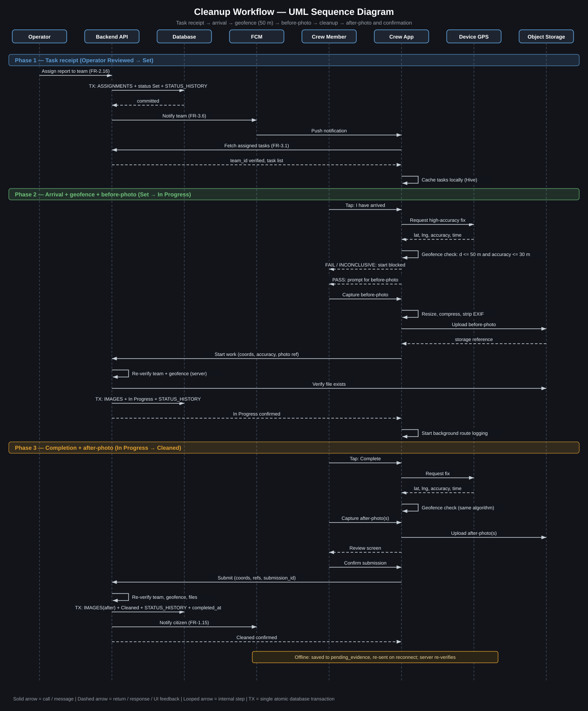

# Cleanup Workflow — UML Sequence Diagram & Geofence Verification

## CleanOps (CleanStreet AI) — Cleaning Crew App

---

## 1. Purpose and Scope

This document specifies, as a formal UML sequence diagram, the end-to-end interaction for a cleaning job: **task receipt → team arrival → geofence check (crew within 50 m of the report site) → before-photo upload → cleanup → after-photo upload and confirmation.** It also defines the geofence verification algorithm and its formula.

It builds on, and does not redefine:

- Report Lifecycle State Machine (states `Set → In Progress → Cleaned`)
- Task Assignment & Notification Flow (FR-3.1, FR-3.6)
- Completion Evidence Submission (Rev. 2) — the atomic confirmation transaction
- Field-Team Architecture — client structure, offline `pending_evidence` queue, background route logging

State names use the finalized nine-state model.

---

## 2. Participants

| Participant | Role |
|---|---|
| **Operator** | Assigns the report to a team (Operations Dashboard) |
| **Backend API** | Orchestrates transitions, authorization, geofence re-verification, transactions |
| **FCM** | Delivers the push notification (external service) |
| **Crew App** | Flutter Cleaning Crew application (MVVM / Cubit) |
| **Device GPS** | Location provider on the crew member's phone |
| **Object Storage** | Firebase Storage / S3 (external service) |
| **Database** | PostgreSQL + PostGIS (REPORTS, ASSIGNMENTS, IMAGES, STATUS_HISTORY) |

The Citizen is not a participant in this flow; the citizen only receives status notifications as a downstream effect (FR-4.8).

---

## 3. UML Sequence Diagram

```mermaid
sequenceDiagram
    autonumber
    actor Op as Operator
    participant BE as Backend API
    participant DB as Database
    participant FCM as FCM
    actor Crew as Crew Member
    participant App as Crew App
    participant GPS as Device GPS
    participant OS as Object Storage

    rect rgb(30, 40, 55)
    Note over Op,FCM: Phase 1 - Task receipt (state: Operator Reviewed to Set)
    Op->>BE: Assign report to team (FR-2.16)
    BE->>DB: TX: insert ASSIGNMENTS, status = Set, insert STATUS_HISTORY
    DB-->>BE: committed
    BE->>FCM: Notify assigned team (FR-3.6)
    FCM-->>App: Push notification
    App->>BE: Fetch assigned tasks (FR-3.1)
    BE->>BE: Verify team_id matches ASSIGNMENTS.team_id
    BE-->>App: Task list with location, category, priority
    App->>App: Cache tasks locally (Hive)
    end

    rect rgb(30, 50, 40)
    Note over Crew,OS: Phase 2 - Arrival and geofence check (state: Set to In Progress)
    Crew->>App: Tap "I have arrived"
    App->>GPS: Request high-accuracy fix
    GPS-->>App: lat, lng, accuracy, timestamp
    App->>App: Geofence check (Section 4)
    alt accuracy too poor (above 30 m)
        App-->>Crew: "GPS signal weak, move to open sky and retry"
    else outside 50 m radius
        App-->>Crew: "You are X m from the site" (start blocked)
    else inside 50 m radius
        App-->>Crew: Prompt for before-photo
        Crew->>App: Capture before-photo
        App->>App: Resize, compress, strip EXIF
        App->>OS: Upload before-photo
        OS-->>App: storage reference
        App->>BE: Start work (report_id, lat, lng, accuracy, timestamp, photo ref)
        BE->>BE: Verify team_id and re-run geofence check server-side
        BE->>OS: Verify file exists
        alt server geofence check fails
            BE-->>App: 422 geofence_failed (start rejected)
        else passes
            BE->>DB: TX: insert IMAGES (before photo), status = In Progress, insert STATUS_HISTORY
            DB-->>BE: committed
            BE-->>App: In Progress confirmed
            App->>App: Start background route logging
        end
    end
    end

    rect rgb(50, 45, 30)
    Note over Crew,OS: Phase 3 - Cleanup and after-photo (state: In Progress to Cleaned)
    Crew->>App: Cleanup finished, tap "Complete"
    App->>GPS: Request high-accuracy fix
    GPS-->>App: lat, lng, accuracy, timestamp
    App->>App: Geofence check (same algorithm)
    alt fails geofence or accuracy
        App-->>Crew: Completion blocked, return to site
    else passes
        Crew->>App: Capture after-photo(s)
        App->>App: Resize, compress, strip EXIF
        App->>OS: Upload after-photo(s)
        OS-->>App: storage references
        App-->>Crew: Review screen
        Crew->>App: Confirm submission
        alt device online
            App->>BE: Submit completion (report_id, photo refs, lat, lng, accuracy, timestamp, submission_id)
            BE->>BE: Verify team_id, re-run geofence check, verify files exist
            BE->>DB: TX: insert IMAGES (after), status = Cleaned, insert STATUS_HISTORY, set ASSIGNMENTS.completed_at
            DB-->>BE: committed
            BE->>FCM: Notify citizen of status change (FR-1.15)
            BE-->>App: Cleaned confirmed
            App->>App: Stop route logging, upload route log
        else device offline
            App->>App: Save to pending_evidence (with geofence result and coordinates)
            App-->>Crew: "Saved, will submit when online"
            Note over App,BE: On reconnect the same submission is sent, server re-verifies
        end
    end
    end

    Note over Op,BE: Operator review (Cleaned to Validated or back to In Progress) is defined in Report Lifecycle and Operator Rejection/Rework Handling
```



> **Rendering:** GitHub renders the Mermaid block above automatically once the file is pushed. In VS Code it needs a Mermaid-capable markdown preview extension.
>
> **No-extension version:** the same diagram as a standalone image, `cleanup-sequence-diagram.svg`, placed in the same folder:
>
> 

---

## 4. Geofence Verification Algorithm

### 4.1 Parameters

| Symbol | Meaning | Value |
|---|---|---|
| `R_geo` | Geofence radius | **50 m** |
| `A_max` | Maximum acceptable GPS horizontal accuracy | **30 m** (starting value, see 6.2) |
| `R_earth` | Mean Earth radius | 6,371,000 m |
| `(φ₁, λ₁)` | Report site, from `REPORTS.latitude / longitude`, in radians | — |
| `(φ₂, λ₂)` | Crew device fix, in radians | — |
| `acc` | Horizontal accuracy reported by the device for that fix | meters |

### 4.2 Distance (Haversine formula)

```
Δφ = φ₂ − φ₁
Δλ = λ₂ − λ₁

a = sin²(Δφ / 2) + cos(φ₁) · cos(φ₂) · sin²(Δλ / 2)

d = 2 · R_earth · atan2( √a , √(1 − a) )          (meters)
```

### 4.3 Decision rule

```
if acc > A_max:           result = INCONCLUSIVE   (ask the crew to retry, do not pass or fail)
else if d ≤ R_geo:        result = PASS
else:                     result = FAIL
```

- The boundary is **inclusive**: `d = 50.0 m` passes, `d = 50.1 m` fails.
- `INCONCLUSIVE` is deliberately separate from `FAIL`: a poor fix says nothing about where the crew actually is.

### 4.4 Pseudocode

```dart
enum GeofenceResult { pass, fail, inconclusive }

GeofenceResult checkGeofence({
  required double siteLat, required double siteLng,
  required double fixLat,  required double fixLng,
  required double accuracyMeters,
  double radiusMeters = 50,
  double maxAccuracyMeters = 30,
}) {
  if (accuracyMeters > maxAccuracyMeters) return GeofenceResult.inconclusive;
  final d = haversineMeters(siteLat, siteLng, fixLat, fixLng);
  return d <= radiusMeters ? GeofenceResult.pass : GeofenceResult.fail;
}
```

### 4.5 Worked examples

Using 1° of latitude ≈ 111,195 m:

| Case | Offset from site | d | acc | Result |
|---|---|---|---|---|
| Crew standing at the site | 0.0003° north | ≈ 33.4 m | 8 m | PASS |
| Crew across the street | 0.0006° north | ≈ 66.7 m | 8 m | FAIL |
| Right on the boundary | exactly 50.0 m | 50.0 m | 8 m | PASS |
| Just outside | 50.1 m | 50.1 m | 8 m | FAIL |
| Weak signal | 0.0003° north | ≈ 33.4 m | 45 m | INCONCLUSIVE |

These double as the unit-test cases for the geofence function.

### 4.6 Where the check runs

| Where | Purpose |
|---|---|
| **Crew App** | Immediate feedback to the crew, and it works offline (needs only GPS) |
| **Backend** | The authoritative check. The backend recomputes `d` from the submitted coordinates and never trusts a client-reported "pass" |

The app sends raw `lat, lng, accuracy, timestamp`, not just a boolean, so the server can re-verify, including for submissions that were queued offline and synced later.

---

## 5. Checks Applied at Each Gate

| Gate | Transition | Geofence | Other checks |
|---|---|---|---|
| Start work | `Set → In Progress` | Required (PASS) | `team_id` matches `ASSIGNMENTS.team_id`; before-photo file exists in storage |
| Complete work | `In Progress → Cleaned` | Required (PASS) | `team_id` match; at least one after-photo; explicit confirmation; files exist in storage |

---

## 6. Assumptions, Dependencies, and Open Questions

These are flagged rather than silently decided.

**6.1 Before-photo ownership (schema dependency).** The citizen's original photo and the crew's arrival photo would both be `image_type = before` in the current IMAGES enum, and nothing distinguishes who uploaded them. This diagram assumes the Images Entity Schema addendum adds `uploaded_by` (already requested in review). If it isn't adopted, the schema owner must instead add a distinct image type (e.g. `arrival`). **Decision needed from the schema owner.**

**6.2 Threshold values are provisional.** `R_geo = 50 m` is the specified requirement. `A_max = 30 m` is a proposed starting value to be tuned in field testing.

**6.3 Citizen coordinate precision vs. a 50 m radius.** The reference point is the citizen's GPS fix (which they may have nudged on the map). Phone GPS error is commonly 5–20 m on each side, so the combined error can consume a large part of a 50 m radius in dense areas. If real-world false failures appear, the options are a larger radius or an operator override. Neither is specified here.

**6.4 Failure path with no override.** As written, a crew that cannot pass the geofence cannot start or complete the task. An operator override or manual-exception flow does not exist in the current requirements, so none is defined. Raise this with the Operations Dashboard owner if needed.

**6.5 Spoofed location.** The server re-verification protects against a tampered "pass" flag, but not against a spoofed GPS source on the device. Mock-location detection is a Security Requirements concern and is not specified here.

**6.6 Idempotency.** Offline-synced submissions carry a `submission_id` so a retry after a partial success does not create duplicate IMAGES rows (requirement on the backend, as already noted in the Field-Team Architecture).

---

## 7. Summary

- The sequence has three phases: task receipt (`Set`), arrival with geofence and before-photo (`In Progress`), and completion with geofence and after-photo (`Cleaned`).
- The geofence uses the Haversine distance between the report site and the crew's fix, with a pass when `d ≤ 50 m` and `accuracy ≤ 30 m`. A poor fix gives *inconclusive*, never a fail.
- The app checks first for fast feedback and offline use. The backend re-verifies from raw coordinates and is the authority.
- The IMAGES row, status change, STATUS_HISTORY entry, and `completed_at` still happen in a single atomic transaction at confirmation, as defined in Completion Evidence Submission.
- Open items: before-photo ownership in the schema, the `A_max` value, citizen/crew GPS error against the 50 m radius, and the lack of an override path.

---

## 8. Where the Haversine Formula Comes From

The haversine function is `hav(θ) = sin²(θ / 2)`. The law of haversines for two points on a sphere says:

```
hav(d / R) = hav(Δφ) + cos(φ₁) · cos(φ₂) · hav(Δλ)
```

Calling the right-hand side `a` and solving for `d`:

```
d = 2 · R · arcsin( √a )  =  2 · R · atan2( √a , √(1 − a) )
```

The `atan2` form is the one used in this document because it stays numerically stable for very small distances, which is exactly the 0–100 m range a geofence works in.

Two practical notes:

- **At 50 m the Earth's curvature is negligible.** A flat-plane approximation would be accurate to well under 0.01 %. Haversine is still used because it is a few lines of code, needs no special cases near the poles or the 180° meridian, and removes any argument about which approximation is "good enough".
- **App and server can differ by centimetres.** The server can run the check in PostGIS, e.g. `ST_DWithin(report_location::geography, device_point::geography, 50)`, which measures on the WGS84 spheroid rather than a sphere. The difference from the spherical formula is at most about half a percent, which is a matter of centimetres at 50 m. A fix that is almost exactly on the boundary could therefore pass in the app and fail on the server. This is expected, and it is why the server result is the authoritative one and the app result is only immediate feedback.

---

## 9. User-Facing Messages

These are the messages the Crew App shows for each outcome. Wording is a starting point for the UI owner.

| Situation | Where detected | Message shown to the crew | Can retry? |
|---|---|---|---|
| Location permission denied | App | "Location access is needed to verify you are at the site. Enable it in Settings." | Yes, after enabling |
| GPS switched off on the device | App | "Turn on location (GPS) to continue." | Yes |
| Weak fix (`acc > 30 m`) | App | "GPS signal is weak. Move to an open area and try again." | Yes |
| Outside the radius (`d > 50 m`) | App | "You are about {d} m from the site. Move closer to start / complete." | Yes |
| Server geofence check fails | Backend returns `422 geofence_failed` | "We could not confirm you are at the site. Please try again from the site." | Yes |
| Team does not match the assignment | Backend returns `403` | "This task is no longer assigned to your team." (task is also removed from the cached queue) | No |
| Before / after photo missing | App | "Take at least one photo to continue." | Yes |
| Upload failed or file not found in storage | Backend | "Photo upload did not finish. Please retry." | Yes |
| No connectivity at completion | App | "Saved. It will be sent when you are back online." | Automatic |

The distance in the "outside the radius" message is shown rounded to the nearest 5 m, so the crew sees a useful direction without the screen implying more precision than a phone GPS has.

---

## 10. Offline Behaviour Recap

This section only summarises what the Field-Team Architecture document already defines, so this document can be read on its own.

| Action | Works offline? | Notes |
|---|---|---|
| View cached task list and details | Yes | Read from the Hive cache |
| Capture photos and compress them | Yes | Local only |
| Run the geofence check | Yes | Needs only the device GPS |
| **Start work** (`Set → In Progress`) | **No (as specified here)** | Needs the backend to record the transition and the before-photo |
| **Complete work** (`In Progress → Cleaned`) | Queued | Saved to `pending_evidence` and sent on reconnect; the server re-verifies the geofence from the stored coordinates |

**Open question this exposes.** The Field-Team Architecture only defines an offline queue for evidence submission, not for starting work. If a crew arrives in a no-signal area, passes the geofence, and cannot register the start, they cannot legitimately move the report to `In Progress`. Completing offline would then try to take a report from `Set` straight to `Cleaned`, which the Report Lifecycle model does not allow (no skipped states). There are two ways to resolve it, and the team needs to choose:

1. **Queue the start as well.** The before-photo and start event go into the offline queue and are replayed in order (start, then completion) on reconnect. This keeps the lifecycle intact but needs an ordering guarantee in the sync logic.
2. **Require connectivity to start.** Simpler, but a crew in a dead zone is blocked until they find a signal.

This document does not choose between them. It should go to the owner of the Field-Team Architecture and the backend lifecycle implementation.
