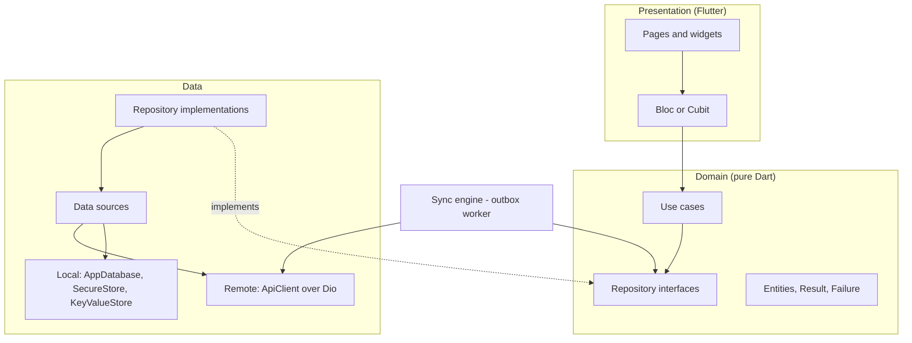

# Flutter State Management & Mobile App Skeleton Specification
### CleanStreet AI — Flutter Mobile Architecture & Client Workflows

**Proposed repository path:** `docs/design/mobile/flutter-state-management-skeleton.md` *(the task does not state a path — confirm it before submitting)*

**Scope:** Flutter clean architecture with Bloc, the project directory layout, the dependency injection container, the HTTP network layer, and the local storage and caching contracts. It applies to both mobile apps: the Citizen app and the Field Cleaning-Team app.

**Related documents:** Citizen Mobile App Architecture (offline queue, GPS fallback, image pipeline), Field Cleaning-Team Mobile Architecture, API Protection and Rate Limiting Requirements, Availability & Reliability Requirements.

**Status:** draft for team approval. Several choices below close items that the earlier documents left as open decisions (Section 12).

---

## 0. Source and Gap Note

The proposal establishes Flutter as the proposed mobile technology, "or a native Android implementation, subject to the team's final technology decision" (Section 14); REST APIs over a PostgreSQL/PostGIS backend (Sections 14, 15); Firebase Authentication and Cloud Messaging as candidate services (Section 13); and the Citizen workflow (Figure 6). This task confirms Flutter.

**Figma and proposal alignment.** The Figma material available is the System Workflow page: the **Citizen / User Workflow** (4.1, Figure 6), the Operator Workflow (4.2) and AI-Assisted Decision Support (4.3). Feature modules, Blocs and screens in this document use the Citizen workflow's node names and order (Section 11.1). The Operator workflow belongs to the operations dashboard and is outside the mobile skeleton, apart from the Field app extension, which has its own document. No screen-level UI designs were available.

The proposal does **not** specify an app architecture, a state-management library, a project layout, dependency injection, a network layer, or a caching strategy. Everything below is a **proposed implementation requirement**. Package names are proposals and exact versions are pinned when the project is created. The Dart snippets are illustrative skeletons; they have not been compiled in this environment, so they need a compile pass when the project is generated.

The backend API contract is not defined in the proposal beyond the ideas in the earlier documents (for example `POST /reports`). The endpoint list in Section 6.5 is therefore an **assumed client-side contract** to confirm with the backend team.

---

## 1. Goals and Principles

| Principle | Consequence |
|---|---|
| Clean architecture | Dependencies point inward: presentation → domain ← data. The domain layer is pure Dart with no Flutter, network or database imports |
| Offline-first | Anything the user submits is written locally first; a sync engine is the only component that sends it |
| One state-management approach | Bloc/Cubit everywhere, so state machines (report wizard, task execution, queue items) look the same in both apps |
| Testable by construction | Every class takes its dependencies through its constructor; the layers can be tested without a device |
| Errors are values | Layers return `Result` objects instead of throwing across boundaries |
| Shared code, separate apps | Common infrastructure lives in packages; the Citizen and Field apps are thin shells over feature modules |

---

## 2. Clean Architecture Layers



| Layer | Contains | May depend on | Must not depend on |
|---|---|---|---|
| **Presentation** | Pages, widgets, Bloc/Cubit, UI state | Domain | Data, Dio, drift |
| **Domain** | Entities, use cases, repository **interfaces**, `Result`, `Failure` | Nothing but Dart | Flutter, Dio, drift, Firebase |
| **Data** | Repository implementations, data sources, DTOs, mappers | Domain, `core_network`, `core_storage` | Presentation |

**Three kinds of model, kept apart:** *entities* (domain, what the app reasons about), *DTOs* (data, the JSON shape of the API), and *table rows* (data, the SQLite shape). Mappers convert between them, so a backend field rename never reaches a widget.

**Use cases** are small single-purpose classes (`EnqueueReport`, `ResolveLocation`, `ProcessImage`, `WatchReportHistory`). Blocs call use cases, never repositories directly. This keeps rules such as "location and image are mandatory" in one tested place.

### 2.1 Result and Failure

```dart
sealed class Result<T> { const Result(); }
final class Ok<T> extends Result<T> { const Ok(this.value); final T value; }
final class Err<T> extends Result<T> { const Err(this.failure); final Failure failure; }

sealed class Failure { const Failure(this.message); final String message; }
final class NetworkFailure extends Failure { const NetworkFailure() : super('No connection'); }
final class TimeoutFailure extends Failure { const TimeoutFailure() : super('Request timed out'); }
final class UnauthorizedFailure extends Failure { const UnauthorizedFailure() : super('Session expired'); } // 401 after one refresh
final class ForbiddenFailure extends Failure { const ForbiddenFailure() : super('Not allowed'); }          // 403, never refreshed
final class NotFoundFailure extends Failure { const NotFoundFailure() : super('Not found'); }               // 404, e.g. a deleted report or another user's report ID
final class ConflictFailure extends Failure { const ConflictFailure() : super('Conflict'); }                // 409
final class ValidationFailure extends Failure {
  const ValidationFailure(this.fieldErrors) : super('Invalid input');
  final Map<String, String> fieldErrors;                                                                     // 400, 413 (and 422 if the backend uses it)
}
final class RateLimitedFailure extends Failure {
  const RateLimitedFailure(this.retryAfter) : super('Too many requests');
  final Duration? retryAfter;                                                                                // 429
}
final class ServerFailure extends Failure { const ServerFailure() : super('Server error'); }                 // 5xx
final class StorageFailure extends Failure { const StorageFailure(super.message); }
final class LocationFailure extends Failure { const LocationFailure(super.message); }
final class UnknownFailure extends Failure { const UnknownFailure(super.message); }
```

The failure types line up with the status-code handling already specified for the citizen app (401 → `paused_auth`, 403 → pause with a message, 429 → honor `Retry-After`, 4xx → failed with field errors, 5xx and timeouts → retry with backoff).

```dart
abstract interface class UseCase<Out, In> { Future<Result<Out>> call(In input); }
```

### 2.2 Cross-Feature Contracts

Agreed once and used by every feature, so parallel work does not diverge.

| Contract | Rule |
|---|---|
| Failure model | The `Failure` types in 2.1, each mapped to a safe, user-presentable message in the presentation layer. Features add no private error types |
| Session interface | One `SessionProvider` in `core` (current user ID, role, token state, a `SessionExpired` stream). No feature reads tokens itself |
| Authorization boundary | The **server** checks the token, role, resource ownership and permissions. Hiding a button or a route is a usability aid, never authorization. Client route guards mirror the role (citizen or field team) but are not trusted |
| Server authority | Cached or queued data never overrides the server's report ID, status or permissions. A report is shown as submitted only after the backend confirms it (Section 3.5) |
| Time | The API sends UTC timestamps. They are parsed as UTC in the data layer and formatted for the user's locale only in presentation |
| Pagination | One `Page<T>` type (items plus an optional next cursor). The cursor form is assumed until the backend defines it (Section 6.5) |
| Cache freshness | Cached reads carry `Cached<T>` (`source`, `fetchedAt`, `isStale`), and the UI shows a stale or offline indicator accordingly |
| Image references | On the device: app-private file references. On the server: object-storage references. The two are never mixed in one field |
| Configuration | Environment base URLs and public client configuration come from `AppConfig`. Server-only secrets (service-role or admin keys) never exist in the app |

---

## 3. State Management: Bloc / Cubit

**Decision: `flutter_bloc` (Bloc and Cubit).** Riverpod is the alternative; Appendix A maps one to the other.

**Why Bloc fits this project**
- The app is built around **explicit state machines**: the report wizard, the queue-item lifecycle (`draft → queued → uploading → paused_auth → submitted | failed | expired`) and the field task state machine (`Assigned → En Route → Arrived → Cleaning In Progress → …`). Bloc's event → state transitions make each allowed transition visible and testable, and a test can assert that an illegal transition is rejected (for example "Start Cleaning" before the geofence passes).
- Events give a natural log for audit-sensitive actions such as geofence overrides.
- `bloc_test` makes transition tests short, which matters for a student team with a fixed timeline.
- It is the same pattern in both apps and in every feature, so reviewers read one style.

**Choose Riverpod instead if** the team prefers less boilerplate and wants state and DI in one tool. Nothing else in this specification changes, because the domain and data layers do not know which library the presentation layer uses.

### 3.1 Rules

| Rule | Detail |
|---|---|
| Cubit vs Bloc | **Cubit** for simple, method-driven state (a form, a list). **Bloc** when transitions depend on events and guards (`TaskExecutionBloc`, `SyncStatusBloc`) |
| One per feature screen | A Bloc/Cubit serves one screen or flow, named `<Feature><Role>` (`ReportWizardCubit`, `ReportHistoryBloc`) |
| Depend on use cases only | A Bloc takes use cases in its constructor. It never touches Dio, drift or `SecureStore` |
| No Bloc-to-Bloc dependency | Share data through repository streams (for example the outbox stream), not by one Bloc listening to another |
| Immutable state | States are immutable and use `Equatable` (or `freezed`, if the team adopts code generation) |
| Sealed state hierarchies | Screens with distinct modes use sealed states (`Loading`, `Loaded`, `Failed`) so the UI `switch` is exhaustive |
| One-time effects | Navigation and snackbars come from `BlocListener` on a dedicated state or effect stream, never from the build method |
| No logic in widgets | Widgets render state and dispatch events; validation and rules live in use cases |
| Scope | App-level: `AuthBloc`, `ConnectivityCubit`, `SyncStatusBloc`. Feature-level: created with the route and closed with it |

### 3.2 Example: report wizard

```dart
enum WizardStep { photo, location, category, description, review }

final class ReportWizardState extends Equatable {
  const ReportWizardState({
    this.step = WizardStep.photo,
    this.image,            // PreparedImage? — output of ProcessImage
    this.location,         // ResolvedLocation? — coordinates, accuracy, source
    this.categoryId,
    this.description = '',
    this.submission = const SubmissionIdle(),
  });
  final WizardStep step;
  final PreparedImage? image;
  final ResolvedLocation? location;
  final int? categoryId;
  final String description;
  final SubmissionStatus submission; // Idle | Saving | Queued(localId) | ServerConfirmed(trackingId) | NeedsAttention(failure)

  // copyWith omitted for brevity
  bool get canSubmit => image != null && location != null && categoryId != null; // mandatory trio
  @override List<Object?> get props => [step, image, location, categoryId, description, submission];
}

final class ReportWizardCubit extends Cubit<ReportWizardState> {
  ReportWizardCubit(this._processImage, this._resolveLocation, this._enqueueReport, this._watchSubmission)
      : super(const ReportWizardState());
  final ProcessImage _processImage;
  final ResolveLocation _resolveLocation;
  final EnqueueReport _enqueueReport;
  final WatchSubmission _watchSubmission; // outbox stream: Queued → ServerConfirmed | NeedsAttention

  Future<void> photoPicked(RawImage raw) async { /* run _processImage, emit image or failure */ }
  void categoryChosen(int id) => emit(state.copyWith(categoryId: id));
  Future<void> submit() async {
    if (!state.canSubmit || state.submission is SubmissionSaving) return; // double-tap guard
    emit(state.copyWith(submission: const SubmissionSaving()));
    final result = await _enqueueReport(NewReportDraft.from(state));
    emit(switch (result) {
      Ok(:final value) => state.copyWith(submission: SubmissionQueued(value)), // saved on the device, NOT yet accepted by the server
      Err(:final failure) => state.copyWith(submission: SubmissionFailed(failure)),
    });
  }
}
```

The wizard only ever **enqueues**. Sending is the sync engine's job, so online and offline submission are the same path (as the citizen app document requires).

### 3.3 Example: field task execution (Bloc)

| Event | Allowed from | Guard | New state |
|---|---|---|---|
| `HeadingToSite` | Assigned | — | EnRoute (starts telemetry) |
| `GeofenceChecked` | EnRoute | Distance ≤ radius + accuracy | Arrived |
| `OverrideRequested` | EnRoute | Reason provided; needs operator approval | EnRoute (pending) |
| `StartCleaningPressed` | Arrived | — | CleaningInProgress |
| `EvidenceCaptured` | CleaningInProgress | At least one photo stored locally | EvidenceCaptured |
| `SubmitPressed` | EvidenceCaptured | — | SubmittedForReview (stops telemetry) |

Any event received from a state that does not allow it is ignored and logged. This enforces the hard geofence gate in the Field app document.

### 3.4 Citizen-facing status labels

The proposal names visible status feedback — **acknowledged / in progress / resolved** — as the primary adoption lever (Section 19), and Figure 6 shows it as *Track Report Progress*. The domain layer keeps the server's status values; presentation maps them to three labels *(proposed wording)*:

| Server status (Citizen Functions) | Citizen label |
|---|---|
| Submitted, Under Review | Acknowledged |
| Assigned, In Progress | In progress |
| Resolved | Resolved |

Items that exist only on the device are labeled separately (Section 3.5), never with a server status.

### 3.5 Submission states and what the citizen is told

| Outbox status | Report-creation state | What the citizen sees |
|---|---|---|
| `draft` | Editing | The wizard |
| `queued`, `uploading` | `Queued` | "Saved — will send when you're back online" (offline) or "Sending…" (online), with a "Pending" local reference. Never "submitted" |
| `pausedAuth` | `NeedsAttention` | "Sign in to send your report" |
| `failed` | `NeedsAttention` | The server's field errors, with edit and resubmit |
| `expired` | `NeedsAttention` | "This report could not be sent for 7 days" — retry or discard |
| `submitted` | `ServerConfirmed` | **Report Successfully Submitted** (Figure 6) with the server's tracking ID |

Only `ServerConfirmed` shows the tracking ID or the success message. AI analysis runs after the backend accepts the report (the Figure 6 side note "Report Sent for AI-assisted analysis"), so the client has no step for it.

---

## 4. Project Directory Layout

A **modular monorepo** with one Flutter workspace, shared packages, and two thin app shells. A tool such as Melos runs commands across packages.

```
cleanstreet-mobile/
├── melos.yaml
├── analysis_options.yaml
├── .github/workflows/ci.yaml
├── apps/
│   ├── citizen_app/
│   │   ├── lib/
│   │   │   ├── main_dev.dart            # one entry point per flavor
│   │   │   ├── main_staging.dart
│   │   │   ├── main_prod.dart
│   │   │   ├── bootstrap.dart           # error zone, DI, runApp
│   │   │   ├── app.dart                 # MaterialApp.router, theme, l10n
│   │   │   ├── di/injection.dart        # composition root
│   │   │   ├── router/app_router.dart   # go_router, auth guards, deep links
│   │   │   └── features/
│   │   │       ├── auth/                # session check; Have an account? → Register → Login
│   │   │       ├── home/                # Home Dashboard; queued-item banner
│   │   │       ├── report_create/       # Create New Report: image, GPS, category, description, review, submit
│   │   │       ├── report_queue/        # queued / failed / paused items and their status
│   │   │       ├── report_history/      # previously submitted reports
│   │   │       ├── report_tracking/     # Track Report Progress, View Completion Evidence, Rate / Confirm Resolution
│   │   │       └── notifications/       # Received Notification / Updates
│   │   ├── test/
│   │   ├── integration_test/
│   │   ├── android/  ios/
│   │   └── pubspec.yaml
│   └── field_app/                       # same shape
│       └── lib/features/
│           ├── auth/                    # reuses the shared auth module
│           ├── tasks/                   # assigned task list and detail
│           ├── task_execution/          # state machine, arrival check
│           ├── evidence_capture/        # camera, local queue status
│           └── telemetry/               # assignment-scoped GPS pings
└── packages/
    ├── core/            # Result, Failure, AppConfig, logging, constants
    ├── core_network/    # ApiClient, interceptors, error mapping, DTO base
    ├── core_storage/    # SecureStore, KeyValueStore, AppDatabase, cache contracts
    ├── shared_domain/   # entities and repository interfaces used by both apps
    ├── sync_engine/     # outbox contracts, SyncWorker, backoff, connectivity
    └── core_ui/         # theme, shared widgets, localization
```

**Inside every feature**

```
features/report_create/
├── data/
│   ├── datasources/     report_local_ds.dart   report_remote_ds.dart
│   ├── models/          new_report_dto.dart    report_row.dart
│   └── repositories/    report_repository_impl.dart
├── domain/
│   ├── entities/        new_report_draft.dart  resolved_location.dart
│   ├── repositories/    report_repository.dart          # interface only
│   └── usecases/        process_image.dart  resolve_location.dart  enqueue_report.dart
└── presentation/
    ├── bloc/            report_wizard_cubit.dart  report_wizard_state.dart
    ├── pages/           report_wizard_page.dart
    └── widgets/
```

**Dependency rules between packages**

| Package | May depend on |
|---|---|
| `core` | nothing (pure Dart) |
| `shared_domain` | `core` |
| `core_network`, `core_storage` | `core` |
| `sync_engine` | `core`, `shared_domain`, `core_network`, `core_storage` |
| `core_ui` | `core` |
| Apps | all packages |

The domain layer is kept free of Flutter, Dio and drift by an import-lint rule in CI (proposed), so a forbidden import fails the build.

**Conventions:** files in `snake_case`, one public class per file; `*_bloc`, `*_cubit`, `*_state`, `*_event`; interfaces named by role (`ReportRepository`) and implementations suffixed `Impl`; feature code never imports another feature directly, only `shared_domain`.

**Scope control:** start with `citizen_app` plus `core`, `core_network`, `core_storage`, `shared_domain` and `sync_engine`. Add `field_app` once the shared packages are stable. A single-app project with flavors is a valid simplification if the team prefers it; the layering above is unchanged.

---

## 5. Dependency Injection Container

**Decision: `get_it` as a service locator used only at the composition root.** Classes receive their dependencies by constructor, so tests build them by hand without any container.

| Rule | Detail |
|---|---|
| Composition root | All registration happens in `di/injection.dart`, called from `bootstrap.dart` |
| Constructor injection | No class calls `getIt<T>()` internally. The only `getIt` calls are in the composition root and where a `BlocProvider` creates a Bloc |
| Register interfaces | Register `ReportRepository` (the interface) mapped to `ReportRepositoryImpl`, never the implementation type |
| Lifetimes | **Singleton:** `Dio`, `AppDatabase`, `SecureStore`, `TokenStore`, `SyncWorker`, repositories. **Factory:** every Bloc/Cubit and use case |
| Session scope | A `session` scope holds user-bound objects and is popped on logout |
| Environments | Flavor entry points pass an `AppConfig` (base URL, log level, feature flags) into `configureDependencies` |
| Test overrides | Tests register fakes in a fresh container or reset it between tests |

```dart
final getIt = GetIt.instance;

Future<void> configureDependencies(AppConfig config) async {
  // Infrastructure — app lifetime
  getIt.registerSingleton<AppConfig>(config);
  getIt.registerSingleton<SecureStore>(FlutterSecureStoreImpl());
  getIt.registerSingleton<KeyValueStore>(await SharedPrefsStore.open());
  getIt.registerSingleton<AppDatabase>(await AppDatabase.open(key: await getIt<SecureStore>().dbKey()));
  getIt.registerSingleton<TokenStore>(TokenStoreImpl(getIt()));
  getIt.registerSingleton<AuthEvents>(AuthEvents());               // session-expired broadcast stream
  getIt.registerSingleton<Dio>(buildDio(config, getIt(), getIt()));
  getIt.registerSingleton<ApiClient>(ApiClient(getIt()));

  // Repositories — interfaces mapped to implementations
  getIt.registerSingleton<CategoryRepository>(CategoryRepositoryImpl(getIt(), getIt()));
  getIt.registerSingleton<ReportRepository>(ReportRepositoryImpl(getIt(), getIt(), getIt()));
  getIt.registerSingleton<OutboxStore>(DriftOutboxStore(getIt()));

  // Sync engine
  getIt.registerSingleton<SyncWorker>(SyncWorker(
    store: getIt(), connectivity: getIt(), auth: getIt(),
    handlers: [CreateReportHandler(getIt())],
  ));

  // Use cases and Blocs — new instance each time
  getIt.registerFactory(() => EnqueueReport(getIt()));
  getIt.registerFactory(() => ReportWizardCubit(getIt(), getIt(), getIt(), getIt()));
}

// Session scope: user-bound objects, discarded at logout
void enterSession(String userId) => getIt.pushNewScope(
      scopeName: 'session',
      init: (g) => g.registerSingleton<CurrentUser>(CurrentUser(userId)),
    );
Future<void> leaveSession() => getIt.popScope();
```

**Logout rule:** popping the session scope clears user-bound caches and tokens, but **the outbox is not wiped**. Queued reports stay encrypted and tied to their `user_id`, and the sync engine only sends items owned by the currently signed-in user (citizen app document, Section 2).

---

## 6. HTTP Network Layer

**Library:** `dio`. Everything network-related lives in `core_network`; features depend on `ApiClient`, not on Dio.

### 6.1 Layers

| Component | Responsibility |
|---|---|
| `ApiClient` | Thin typed wrapper: `get`, `post`, `postMultipart`, returning `Result` objects |
| `buildDio(config, tokens, auth)` | Creates the Dio instance, base options and interceptor chain |
| Interceptors | Cross-cutting behavior (below) |
| Remote data sources | Build requests, parse DTOs, map them to entities |

### 6.2 Base options (proposed)

| Setting | Value |
|---|---|
| Base URL | From `AppConfig`, per flavor; **HTTPS only** |
| Connect timeout | 10 s |
| Send / receive timeout | 30 s for JSON; 60 s for multipart uploads |
| Default headers | `Accept: application/json`, app version, platform, a correlation ID per request |

### 6.3 Interceptor chain

| # | Interceptor | Behavior |
|---|---|---|
| 1 | **Correlation** | Adds a request ID header so a failed request can be traced in backend logs |
| 2 | **Auth** | Adds `Authorization: Bearer <token>`. On `401`, performs **one** single-flight token refresh (concurrent requests wait on the same refresh) and retries the request once. If refresh fails, emits `SessionExpired` on `AuthEvents`. A `403` is **never** refreshed |
| 3 | **Safe retry** | Retries only idempotent `GET` requests on timeout, connection error or `5xx`: at most 2 retries with exponential backoff and jitter. `POST` is never retried here — outbox jobs are retried by the sync engine |
| 4 | **Logging** | Logs method, path, status and duration. **Never** logs tokens, request bodies, image bytes or coordinates |
| 5 | **Error mapping** | Converts `DioException` and the standard error body into a `Failure` (Section 2.1) |

Interceptor ordering on the error path may differ between Dio versions, so the chain is covered by an automated test that fixes the order for the pinned version (Section 10).

```dart
Dio buildDio(AppConfig c, TokenStore tokens, AuthEvents auth) {
  final dio = Dio(BaseOptions(
    baseUrl: c.apiBaseUrl,
    connectTimeout: const Duration(seconds: 10),
    sendTimeout: const Duration(seconds: 30),
    receiveTimeout: const Duration(seconds: 30),
    headers: {'Accept': 'application/json'},
  ));
  dio.interceptors.addAll([
    CorrelationInterceptor(),
    AuthInterceptor(dio: dio, tokens: tokens, events: auth),   // single-flight refresh, 401 once
    SafeRetryInterceptor(dio: dio, maxRetries: 2),             // idempotent GET only
    RedactedLogInterceptor(level: c.logLevel),
    ErrorMappingInterceptor(),
  ]);
  return dio;
}
```

If Firebase Authentication is adopted, the token comes from the Firebase SDK (`getIdToken`, with a forced refresh on the `401` path) and `TokenStore` wraps that call; the interceptor logic does not change.

### 6.4 Error handling and the standard error body

The client expects this error shape from the backend *(proposed — confirm with the backend specification)*:

```json
{ "code": "VALIDATION_ERROR", "message": "…", "fieldErrors": [ { "field": "categoryId", "message": "…" } ] }
```

| HTTP status | Client failure | Client behavior |
|---|---|---|
| Timeout / no connection | `TimeoutFailure` / `NetworkFailure` | Outbox: retry with backoff. Reads: serve cache |
| `400`, `413` | `ValidationFailure` (field errors) | Outbox item → `failed`; the user corrects and resubmits |
| `401` after one refresh | `UnauthorizedFailure` | Items → `paused_auth`; user signs in again |
| `403` | `ForbiddenFailure` | Pause the queue; show a message; no refresh loop |
| `404` | `NotFoundFailure` | Show a "not available" state (a deleted report or another user's report ID); no retry |
| `409` | `ConflictFailure` | Resolve per the endpoint contract. A replayed `POST /reports` returns the original success (Section 6.5), so a `409` there is unexpected: the outbox item moves to `failed` for review |
| `429` | `RateLimitedFailure(retryAfter)` | Honor `Retry-After`; the quota itself is defined in the API Protection document and not repeated here |
| `5xx` | `ServerFailure` | Retry with backoff |

If the backend returns `422` for validation instead of `400` (the API Protection document specifies `400`), the client maps it to `ValidationFailure` as well.

Retry intervals for outbox jobs reuse the project pattern: 1 → 5 → 15 minutes, then every 15 minutes.

### 6.5 Assumed endpoint contract (client view — to confirm)

| Purpose | Endpoint (assumed) | Used by |
|---|---|---|
| Fetch categories | `GET /categories` | Report wizard |
| Create a report | `POST /reports` (multipart: fields, image, `local_id`) | Sync engine |
| List my reports | `GET /reports?cursor=…` | History |
| Report detail and status history | `GET /reports/{id}` | Tracking |
| Confirm resolution | `POST /reports/{id}/confirmation` | Tracking |
| Register push token | `POST /devices` | Notifications |
| Field: my tasks, status updates, evidence, telemetry | Defined in the Field app and backend specifications | Field app |

Authentication endpoints are not listed because the proposal names Firebase Authentication as a candidate; if a custom auth service is used instead, its endpoints are added here. The server de-duplicates `POST /reports` on `local_id` (stored as `client_report_id`) and returns the original success response for a replay. This is a **backend requirement the outbox depends on**: it must be confirmed in the backend specification, because without it an automatic retry could create a duplicate report.

---

## 7. Local Storage and Caching Contracts

### 7.1 Storage components

| Component | Technology (proposed) | Holds | Protection |
|---|---|---|---|
| `SecureStore` | `flutter_secure_storage` (Keychain / Keystore) | Auth tokens, the database encryption key | Platform secure storage |
| `KeyValueStore` | `shared_preferences` | Non-sensitive settings: onboarding flag, Wi-Fi-only upload, last category refresh time | None needed; never put tokens or personal data here |
| `AppDatabase` | SQLite through `drift`, with SQLCipher | Outbox jobs, cached reports, cached categories | Explicitly encrypted, key in `SecureStore` |
| File store | App-private directory | Compressed report photos, evidence photos | App-private; deleted after confirmed upload |

### 7.2 Contracts (domain-facing interfaces)

```dart
abstract interface class SecureStore {
  Future<String?> read(String key);
  Future<void> write(String key, String value);
  Future<void> delete(String key);
  Future<void> deleteAll();
}

abstract interface class KeyValueStore {
  T? get<T>(String key);
  Future<void> set<T>(String key, T value);
  Future<void> remove(String key);
}

// Read caching
enum CacheStrategy { cacheFirst, networkFirst, staleWhileRevalidate, networkOnly }
enum CacheSource { network, cache }

final class CachePolicy {
  const CachePolicy({required this.strategy, required this.ttl, this.maxEntries});
  final CacheStrategy strategy;
  final Duration ttl;
  final int? maxEntries;
}

final class Cached<T> {
  const Cached(this.data, {required this.source, required this.fetchedAt, required this.isStale});
  final T data;
  final CacheSource source;
  final DateTime fetchedAt;
  final bool isStale;
}

// Repositories expose cached reads as streams, so the UI updates when fresh data arrives
abstract interface class ReportRepository {
  Future<Result<LocalReportId>> enqueueReport(NewReportDraft draft);          // writes to the outbox only
  Stream<List<QueuedReport>> watchQueue();                                    // outbox state for the UI
  Stream<Result<Cached<List<ReportSummary>>>> watchHistory();                 // cache + refresh
  Stream<Result<Cached<ReportDetail>>> watchReport(ReportId id);
  Future<Result<void>> cancelQueued(LocalReportId id);                        // only while still queued
}

abstract interface class CategoryRepository {
  Stream<Result<Cached<List<Category>>>> watchCategories();
}
```

### 7.3 Outbox contract (shared by both apps)

The citizen report queue, the field evidence upload queue, and the telemetry batches have the same needs: durable storage, backoff, idempotency, ownership. They are three **job types** of one outbox in `sync_engine` *(proposed generalization of the two earlier documents)*. The report queue record and lifecycle defined in the citizen app document remain authoritative for the `report` job type.

```dart
enum OutboxStatus { draft, queued, uploading, pausedAuth, submitted, failed, expired }
enum OutboxJobType { createReport, uploadEvidence, telemetryBatch }

abstract interface class OutboxJob {
  String get localId;              // UUID; also the idempotency key
  String get ownerUserId;          // only this user's session may send it
  OutboxJobType get type;
  OutboxStatus get status;
  int get attemptCount;
  DateTime? get nextRetryAt;
}

abstract interface class OutboxStore {
  Future<void> enqueue(OutboxJob job);                                          // transactional with its file reference
  Stream<List<OutboxJob>> watch({required String ownerUserId});
  Future<OutboxJob?> nextEligible({required String ownerUserId, required DateTime now});
  Future<void> update(String localId, {OutboxStatus? status, int? attempt, DateTime? nextRetryAt, String? lastError});
  Future<int> recoverStale({required Duration olderThan});                      // 'uploading' → 'queued' after a crash
  Future<void> remove(String localId);
}

sealed class OutboxOutcome { const OutboxOutcome(); }
final class Delivered extends OutboxOutcome { const Delivered(this.serverId); final String serverId; }
final class RetryLater extends OutboxOutcome { const RetryLater(this.at); final DateTime at; }   // 5xx, timeout, 429
final class PausedForAuth extends OutboxOutcome { const PausedForAuth(); }                       // 401 unresolved, 403
final class Rejected extends OutboxOutcome { const Rejected(this.failure); final Failure failure; } // 4xx validation

abstract interface class OutboxHandler<J extends OutboxJob> {
  OutboxJobType get handles;
  Future<OutboxOutcome> send(J job);
}
```

### 7.4 Cache policy per resource (proposed)

| Resource | Strategy | TTL | Notes |
|---|---|---|---|
| Categories | `cacheFirst` | 24 h | Refreshed at every app launch; the stale list stays usable offline. A removed category surfaces as a validation error on submit |
| Report history | `staleWhileRevalidate` | 5 min | Show the cache at once, refresh in the background; keep the latest 50 reports |
| Report detail and status history | `staleWhileRevalidate` | 2 min | Pull-to-refresh forces `networkFirst` |
| Completion evidence image | Cached by URL, `cacheFirst` | 7 days | Evicted when the report is evicted |
| Auth tokens and the database key | Not a cache — `SecureStore` only | — | Cleared on logout |
| Outbox jobs | Not a cache — durable | Per the 7-day expiry rule | Never evicted automatically |

### 7.5 Invalidation, retention and migration

- A successful report submission invalidates the history cache.
- Logout clears user-bound caches and tokens, **not** the outbox.
- Switching accounts clears all cached reads before the new user's data loads.
- Cached reports older than 30 days (proposed) and beyond the latest 50 are purged on launch.
- The database has an explicit schema version. Every schema change ships with a migration and a migration test that opens a database from the previous version.
- Compressed images are deleted only after confirmed server acceptance, as the citizen app document specifies.

---

## 8. Cross-Cutting Concerns

| Concern | Decision (proposed) |
|---|---|
| Navigation | `go_router` with an auth redirect guard and deep links from push notifications to Report Detail |
| Error boundary | `runZonedGuarded` plus `FlutterError.onError` in `bootstrap.dart`; uncaught errors are logged (redacted) and optionally sent to a crash reporter such as Firebase Crashlytics |
| Logging | A `Logger` interface in `core`; logs never contain tokens, coordinates, image data or personal data |
| Connectivity | `ConnectivityCubit` at app scope, fed to the sync engine and shown as an offline banner |
| Background work | `workmanager` triggers the sync worker, as a best-effort supplement to foreground and connectivity triggers (iOS limits background execution) |
| Localization and theming | `core_ui` holds the theme and externalized strings; the language set and right-to-left support are a team decision |
| Flavors | `dev`, `staging`, `prod` with separate base URLs and credentials |

---

## 9. Dependencies (proposed; versions pinned at project creation)

| Concern | Package |
|---|---|
| State management | `flutter_bloc`, `bloc`, `equatable` |
| Dependency injection | `get_it` |
| HTTP | `dio` |
| Local database | `drift` with SQLCipher support |
| Secure storage and settings | `flutter_secure_storage`, `shared_preferences` |
| Navigation | `go_router` |
| Connectivity and background | `connectivity_plus`, `workmanager` |
| Device features | `geolocator`, `permission_handler`, `image_picker`, `flutter_image_compress` |
| Firebase (candidate) | `firebase_core`, `firebase_auth`, `firebase_messaging` |
| Testing | `bloc_test`, `mocktail`, `integration_test` |
| Tooling | `melos`, `flutter_lints` or `very_good_analysis` |

---

## 10. Testing and Quality Gates

| Layer | Test type | What it proves |
|---|---|---|
| Domain | Pure Dart unit tests | Use-case rules (for example the mandatory image, location and category) and `Result` handling |
| Bloc / Cubit | `bloc_test` | Every allowed transition, and that illegal ones are ignored (for example "Start Cleaning" before arrival) |
| Data | Unit tests with fakes | DTO ↔ entity mappers; repository cache behavior for each `CacheStrategy` |
| Network | Tests with a mock HTTP adapter | Each status code maps to the right `Failure`; one refresh per `401`; no refresh on `403`; `POST` is not retried; **interceptor order is fixed**; logs contain no secrets |
| Outbox and sync | Unit tests with a fake clock and fake handlers | Backoff schedule, `recoverStale`, ownership filtering, `paused_auth` handling |
| Storage | Database tests | Migrations from the previous schema version; the database file is not readable as plain SQLite |
| Widget | Widget tests | Pages render each sealed state |
| Integration | `integration_test` on devices | Airplane-mode report creation delivers exactly one report after reconnecting |

**CI gates (proposed):** format check, static analysis with no warnings, import-lint rules (domain stays pure Dart), unit and Bloc tests with a coverage threshold of 80% for domain and Bloc code, and a debug build of both apps.

---

## 11. Figma and Proposal Alignment

### 11.1 Citizen / User Workflow (Figure 6) → client modules

| Figure 6 node | Module | Bloc / state | Notes |
|---|---|---|---|
| Open CleanStreet AI Mobile Application | `bootstrap`, `auth` | `AuthBloc`: restores a stored session | Routes to Home or to the account decision |
| *Have an account?* → Register → Login | `auth` | `AuthBloc`: `Unauthenticated`, `Authenticating`, `Authenticated`, `SessionExpired` | As drawn, Register leads into Login |
| Home Dashboard | `home` | `HomeCubit`; queued-item banner from `SyncStatusBloc` | Entry point |
| Create New Report | `report_create` | `ReportWizardCubit` | |
| Upload Waste Image | `report_create` | `ProcessImage` use case | Mandatory; one photo in the MVP |
| System Captures GPS Location | `report_create` | `ResolveLocation` use case | Automatic, with the fallback tiers in the citizen app document |
| Select Waste Category | `report_create`, `CategoryRepository` | `categoryChosen` | Cached category list |
| Add Optional Description | `report_create` | `descriptionChanged` | Optional |
| Review Report Details | `report_create` | `WizardStep.review`; `canSubmit` | Image, location and category required |
| Submit Report | `report_create` → outbox → sync engine | `Queued` | Figure 6 side note: the report is sent for AI-assisted analysis after the backend accepts it |
| Report Successfully Submitted | `report_create` | `ServerConfirmed(trackingId)` | Shown only after backend confirmation (Section 3.5) |
| Track Report Progress | `report_history`, `report_tracking` | `ReportHistoryBloc`, `ReportDetailBloc` | Status labels from Section 3.4 |
| Received Notification / Updates | `notifications` | Push message deep-links to Report Detail | Firebase Cloud Messaging is a candidate (Section 13) |
| View Completion Evidence | `report_tracking` | Evidence section of `ReportDetailBloc` | Shown when the server has the cleaning team's evidence |
| Rate / Confirm Resolution (Optional) | `report_tracking` | Optional `ConfirmResolution` action | Never blocks the operator's resolution |

The Operator workflow (4.2) and AI decision support (4.3) run on the operations dashboard and the backend. The client shows only their results (status, evidence). Nothing operator-only (priority score, hotspot checks, team assignment) appears in the citizen app.

### 11.2 Proposal and earlier documents

| Item | Where addressed |
|---|---|
| Flutter as the mobile technology (Section 14) | Sections 1–4 |
| REST APIs over PostgreSQL/PostGIS; images in object storage (Sections 14, 15) | Sections 6, 7; image references in 2.2 |
| Citizen app: submission, status viewing, notifications, history (Section 10) | Features in Section 4; Figure 6 mapping above |
| Visible status feedback as the adoption lever (Section 19) | Section 3.4 |
| Authentication and role-based authorization (Section 17) | Sections 2.2, 6.3; the server is the authorization boundary |
| Data minimization and privacy (Section 17) | Redacted logging (6.3); no location or image data in logs |
| "AI assists, operator decides" (Section 16.3) | The client never computes priority or AI results |
| Citizen app queue, GPS and image pipeline | Reused through `sync_engine`, `core_storage` and the use cases in Section 2 |
| Field app state machine, evidence queue and telemetry | Section 3.3 and the outbox job types in Section 7.3 |
| Token, 401/403 and rate-limit behavior (API Protection) | Sections 6.3 and 6.4 |
| AI service down: report accepted and shown as "Pending AI Analysis" | No client change; handled by the backend |
| Clean architecture, DI, network layer, storage contracts, project layout | Not in the proposal: proposed in Sections 2–7 |

---

## 12. Decisions Closed Here and Decisions Still Open

| # | Item | Status |
|---|---|---|
| 1 | State management | **Proposed: Bloc/Cubit** (Riverpod mapping in Appendix A). Closes open decision 1 of the citizen app document |
| 2 | SQLite library | **Proposed: `drift` with SQLCipher.** Closes open decision 2 of the citizen app document |
| 3 | Dependency injection, HTTP, navigation | **Proposed: `get_it`, `dio`, `go_router`** |
| 4 | Single app with flavors, or the two-app monorepo | Open — the layering is unchanged either way |
| 5 | Certificate pinning | Open — adds security and operational cost (pinned certificate rotation) |
| 6 | Auth provider: Firebase Authentication or a custom service | Open — affects only `TokenStore` and the endpoint list |
| 7 | Backend API contract and error body | Open — the contract in Section 6.5 is assumed; use contract tests against a mock server until it is agreed |
| 8 | Team-member role for the Field app | Open — pending T_85ab37 |
| 9 | Map provider, iOS scope, languages, Wi-Fi-only default, multiple photos | Open — listed in the citizen app document |
| 10 | Backend idempotency for `POST /reports` on `local_id` | Open — the outbox depends on it; confirm with the backend team |
| 11 | Wording of the three citizen status labels (Section 3.4) | Proposed; confirm with the team and the designers |

---

## 13. Acceptance Conditions

| ID | Requirement | Acceptance condition |
|---|---|---|
| AC-01 | Layer separation | The domain layer imports no Flutter, Dio, drift or Firebase package; a CI import-lint rule fails the build otherwise |
| AC-02 | Single state-management approach | Every screen's state is managed by a Bloc or Cubit; no business logic exists in widgets |
| AC-03 | Blocs depend on use cases only | No Bloc or Cubit imports a repository implementation, Dio, or a database class |
| AC-04 | Directory layout | Both apps follow the layout in Section 4; features do not import each other |
| AC-05 | Constructor injection | No class outside the composition root calls the service locator |
| AC-06 | Container lifetimes | Infrastructure objects are singletons; Blocs and use cases are factories; the session scope is discarded on logout |
| AC-07 | Outbox survives logout | After logout and re-login, queued reports remain and are sent only under their owner |
| AC-08 | Network layer isolation | Features reach the network only through `ApiClient`; nothing outside `core_network` imports Dio |
| AC-09 | Auth handling | A `401` triggers at most one refresh per request, concurrent requests share one refresh, and a `403` never triggers a refresh |
| AC-10 | Retry rules | Only idempotent `GET` requests are retried by the interceptor; `POST` retries come only from the outbox, using the 1 → 5 → 15 → every-15-minutes pattern |
| AC-11 | Error mapping | Each status code in Section 6.4, including `404` and `409`, maps to its defined `Failure`, with field errors preserved for `400`, `413` and `422` |
| AC-12 | Log safety | Network and application logs contain no tokens, request bodies, image bytes or coordinates |
| AC-13 | Storage contracts | Tokens and the database key are stored only in `SecureStore`; `KeyValueStore` holds no sensitive data |
| AC-14 | Encrypted database | The SQLite database is verified as encrypted at rest |
| AC-15 | Cache policies | Each resource in Section 7.4 behaves per its strategy and TTL, and cached data is shown with its `source` and `isStale` flag |
| AC-16 | Invalidation | A successful submission invalidates the history cache; switching accounts clears cached reads |
| AC-17 | Migrations | Every schema version has a migration and a migration test |
| AC-18 | Offline end to end | A report created in airplane mode is delivered exactly once after reconnecting |
| AC-19 | Coverage | Domain and Bloc code meet the 80% coverage gate in CI |
| AC-20 | Queued is not submitted | A report shows as submitted, with its tracking ID, only in the `ServerConfirmed` state; queued, sending, paused and failed items are labeled as in Section 3.5 |
| AC-21 | No privileged secret in the app | No service-role or admin credential exists in app source, assets, build variables or logs |
| AC-22 | Server-side authorization | Client role routing and hidden controls are not relied on for access control; the server rejects unauthorized requests, and the client handles `403` and `404` gracefully |
| AC-23 | Backend alignment | Endpoint paths, DTOs, token refresh and idempotency semantics come from the agreed backend specification, not from the assumed contract in Section 6.5 |
| AC-24 | Figma conformance | The citizen flow follows the Figure 6 node order, including *Have an account?* → Register → Login, and status labels follow Section 3.4 |
| AC-25 | Time handling | Timestamps are parsed as UTC in the data layer and formatted for the locale only in presentation |

---

## Appendix A — Bloc to Riverpod Mapping

Use this if the team chooses Riverpod. The domain and data layers, the directory layout, the network layer and the storage contracts do not change.

| Bloc design | Riverpod equivalent |
|---|---|
| `Cubit<State>` | `Notifier<State>` (`AsyncNotifier<State>` for async loading) |
| `Bloc<Event, State>` | A `Notifier` with one method per event, with transition guards inside the methods |
| `BlocProvider(create: …)` | `NotifierProvider` (scoped with `ProviderScope` overrides for feature-level lifetime) |
| `BlocBuilder` / `BlocListener` | `ref.watch` / `ref.listen` |
| `bloc_test` | `ProviderContainer` with overrides, plus `mocktail` |
| `get_it` container | Providers become the container; overrides replace test fakes. Repositories and use cases are exposed as providers |
| Session scope | A provider keyed on the signed-in user ID, invalidated at logout |

---

## Source Note

The proposal establishes Flutter as the proposed mobile technology (Section 14), REST APIs over PostgreSQL/PostGIS (Sections 14, 15), Firebase Authentication and Cloud Messaging as candidate services (Section 13), the `REPORTS`, `IMAGES` and `STATUS_HISTORY` tables (Section 15.2), the Citizen workflow (Figure 6), and the "AI assists, operator decides" principle.

It does **not** specify a client architecture, a state-management library, a project layout, a dependency injection approach, a network layer, a caching strategy, an endpoint contract, or a testing strategy. All of these, including every package, timeout, TTL, retention value and threshold, are proposed implementation requirements to be approved by the team and tuned during development. The Dart code is illustrative and uncompiled. The only Figma material available was the System Workflow page (Figure 6 and the Operator and AI decision-support pages); no screen-level designs were provided, so screens and modules are derived from the Figure 6 nodes.

*End of document.*
